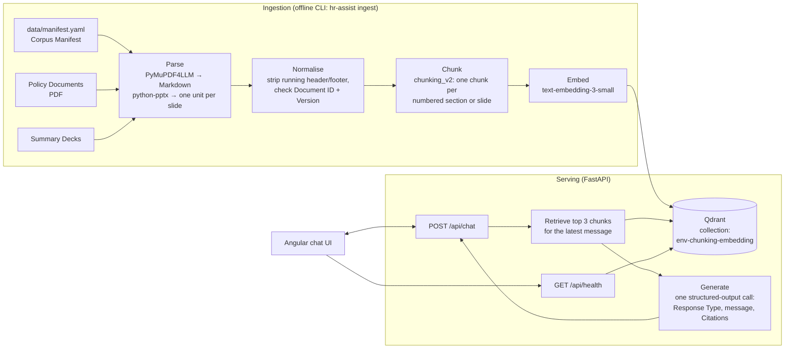

# HR Assist

HR Assist is a chat assistant that answers Northstar Digital Services employees' HR policy questions. Every answer comes only from a fixed Corpus of Policy Documents and Summary Decks. Each Answer cites the document, version, section and page (or slide) it relies on. HR Assist knows the As-Of Date and works out the Applicable Date of each question, so it applies the Document Version that was in force at that time. A Policy Document always prevails over a Summary Deck.

Every reply has a Response Type:

- **Answer**: grounded in the retrieved evidence, with Citations.
- **Clarification**: asks for missing details when the question has several readings that lead to different answers.
- **Abstention**: says the Corpus doesn't cover the question, and points to People Operations.
- **Refusal**: declines when answering would breach privacy or confidentiality, for example a colleague's salary or health.

The domain terms used here (Corpus Manifest, Effective Period, Applicable Date and so on) are defined in [GLOSSARY.md](GLOSSARY.md).

**Try the live demo at <https://hr-assist.naveenmanjappa.com>.** Questions are logged to improve the demo, so don't enter personal information.

Stage 2, deployment, is done. Evaluation is the next stage.

## Architecture



- **Ingestion** reads only the files listed in the Corpus Manifest. It rebuilds the whole Qdrant collection on each run. The collection name combines `APP_ENV`, the chunking version and the embedding model, so changing either one produces a new index rather than overwriting the old one.
- **Answering** always retrieves first, then makes a single LLM call that returns a typed reply. There is no agent loop.
- **The API** has a chat endpoint and a health endpoint. Errors come back in one consistent JSON shape, and every response carries an `X-Request-ID` header.
- **The UI** shows inline citation markers, and under each reply a card for each Citation with its supporting snippet, formatted as headings, lists and tables. It also shows the As-Of Date and connection status. A sidebar (a drawer on small screens) starts a new chat and lists the current conversation. An empty chat offers example questions grouped by what they show: cited Answers, version-aware answers, Clarifications, and Abstentions and Refusals. Light, dark and system themes are styled with Tailwind.

### Deployed

- **Firebase Hosting** serves the Angular build at the custom subdomain, and rewrites `/api/**` to the backend, so the page and the API share one origin.
- **Google Cloud Run** runs the FastAPI container in `europe-west1`, scaling between zero and one instance. API keys come from Secret Manager.
- **GitHub Actions** deploys every merge to `main` once CI passes, then smoke-tests `/api/health` through the public URL. Loading the prod Corpus is a separate workflow you run by hand.
- **Usage limits** protect the public demo: per-IP and global daily rate limits in the app, an output-token cap, and a hard monthly spending limit on the OpenAI project.

The [deployment guide](docs/deployment.md) explains each part and why it was chosen.

Code layout:

| Path | Contents |
| --- | --- |
| [backend/src/hr_assist/corpus/](backend/src/hr_assist/corpus/) | Corpus Manifest loading, chunk model |
| [backend/src/hr_assist/ingestion/](backend/src/hr_assist/ingestion/) | Parser, normaliser, chunking strategy, index rebuild |
| [backend/src/hr_assist/answering/](backend/src/hr_assist/answering/) | Prompt, answerer, OpenAI and Qdrant adapters |
| [backend/src/hr_assist/api/](backend/src/hr_assist/api/) | FastAPI app, routes, error handling, request IDs |
| [frontend/src/app/](frontend/src/app/) | Angular chat UI |
| [data/](data/) | The Corpus and its manifest |
| [evals/](evals/) | Evaluation questions and gold answers (never ingested) |
| [test_fixtures/](test_fixtures/) | Prompt-injection Test Fixture (not ingested yet) |

## Technology choices

| Concern | Choice | Why |
| --- | --- | --- |
| PDF loading | `PyMuPDF4LLMLoader` (Markdown output) | Keeps headings and table rows, which plain text extraction loses. [ADR 0001](docs/adr/0001-document-loading-and-chunking.md) |
| Document facts | Hand-written Corpus Manifest | Document kind and Effective Period drive precedence and date reasoning, so they must be explicit and reviewable. [ADR 0001](docs/adr/0001-document-loading-and-chunking.md) |
| Chunking | Structure-aware, one chunk per numbered section, split at worked-example headings when oversized (`chunking_v2`) | Keeps rules with their conditions, tables with their captions, and each worked example whole. [ADR 0001](docs/adr/0001-document-loading-and-chunking.md), [ADR 0005](docs/adr/0005-split-oversized-sections-at-unnumbered-headings.md) |
| Models | OpenAI `gpt-6-luna` and `text-embedding-3-small`, both configurable | One provider, low cost. [ADR 0002](docs/adr/0002-openai-models-and-two-step-rag.md) |
| Orchestration | Two-step RAG with LangChain, no agent or LangGraph | Every question needs retrieval, so letting a model decide whether to search adds nothing. [ADR 0002](docs/adr/0002-openai-models-and-two-step-rag.md) |
| Vector store | Qdrant (Qdrant Cloud free tier) | Required by the project brief. |
| Backend | Python 3.13, FastAPI, uv | |
| Frontend | Angular 22, Tailwind CSS 4, Vitest | |
| Tracing | LangSmith (optional) | |

Architecture decision records:

- [ADR 0001: Load PDFs as Markdown, describe documents in a Corpus Manifest, and chunk by section](docs/adr/0001-document-loading-and-chunking.md)
- [ADR 0002: OpenAI models, wired as two-step RAG without an agent](docs/adr/0002-openai-models-and-two-step-rag.md)
- [ADR 0003: Run the API on Cloud Run behind a Firebase Hosting rewrite, on a single instance](docs/adr/0003-cloud-run-behind-firebase-hosting.md)
- [ADR 0004: Deploy from GitHub Actions with a service account key, before moving to Workload Identity Federation](docs/adr/0004-service-account-key-before-wif.md)

How HR Assist is deployed, and why, is explained step by step in the [deployment guide](docs/deployment.md).

The [developer guide](docs/developer-guide.md) explains the whole back end: every module, endpoint, setting and pipeline, with the decisions, trade-offs and known gaps.

## Running locally

### Prerequisites

- [uv](https://docs.astral.sh/uv/), which installs Python 3.13 for you
- Node.js 22.22.3+, 24.15+ or 26+, with npm
- An [OpenAI API key](https://platform.openai.com/api-keys)
- A Qdrant cluster. The [Qdrant Cloud](https://cloud.qdrant.io/) free tier is enough: create a cluster, then copy its URL and an API key.
- Optional: a [LangSmith](https://smith.langchain.com/) API key for tracing

### 1. Configure credentials

```sh
cp .env.example .env
```

Fill in `.env` at the repo root. The backend reads it no matter which directory you start it from.

| Variable | Required | Notes |
| --- | --- | --- |
| `APP_ENV` | yes | Any name, e.g. `dev`. It prefixes the Qdrant collection name. |
| `OPENAI_API_KEY` | yes | |
| `QDRANT_URL` | yes | e.g. `https://<cluster-id>.<region>.cloud.qdrant.io:6333` |
| `QDRANT_API_KEY` | yes | |
| `CHAT_MODEL` | no | Defaults to `gpt-6-luna` |
| `MAX_OUTPUT_TOKENS` | no | Caps the length of each reply. Defaults to `800`. |
| `CHUNK_MAX_TOKENS`, `CHUNK_OVERLAP_TOKENS` | no | Part of the chunking strategy, with `CHUNKING_VERSION`: override its size limit and overlap at ingestion. Only the version names the collection, so re-ingesting with new sizes under the same version replaces that collection. |
| `RETRIEVAL_K` | no | Chunks retrieved for each question. Defaults to `3`. |
| `HISTORY_TURNS` | no | Recent messages kept in the prompt. Defaults to `5`. |
| `EMBEDDING_MODEL` | no | Defaults to `text-embedding-3-small`. Changing it means re-ingesting. |
| `LANGSMITH_API_KEY`, `LANGSMITH_TRACING`, `LANGSMITH_PROJECT` | no | Set `LANGSMITH_TRACING=true` to trace each request. EU accounts also need `LANGSMITH_ENDPOINT`. |
| `FRONTEND_ORIGIN` | no | The CORS origin. Defaults to `http://localhost:4200`. |
| `RATE_LIMIT_PER_MINUTE` | no | Chats each client IP may send in a rolling minute. Defaults to `10`. |
| `RATE_LIMIT_PER_DAY` | no | Chats each client IP may send per UTC day. Defaults to `100`. |
| `RATE_LIMIT_GLOBAL_PER_DAY` | no | Chats answered per UTC day across all clients. Defaults to `1000`. |
| `TRUSTED_PROXY_HOPS` | no | How many `X-Forwarded-For` entries, counted from the right, were added by proxies you trust. The client IP is the leftmost of those. `0` ignores the header and uses the socket peer. Defaults to `1`. |

Leave a variable empty to use its default.

### 2. Ingest the Corpus

```sh
cd backend
uv sync
uv run hr-assist ingest
```

This parses every Source Document in [data/manifest.yaml](data/manifest.yaml), prints the chunk count for each document, and rebuilds the collection (for example `dev-chunking_v2-text-embedding-3-small`). It takes about a minute and costs a fraction of a cent in embeddings. Run it again whenever the manifest, the documents or the chunking change.

### 3. Run the backend

```sh
cd backend
uv run uvicorn hr_assist.api.app:create_app --factory --reload
```

The API listens on <http://localhost:8000>. A request to <http://localhost:8000/api/health> should return `{"status":"ok","api":"up","qdrant":"up"}`.

#### Run the container locally

This is the same image that Cloud Run serves. From the repo root:

```sh
docker build -f backend/Dockerfile -t hr-assist-api .
docker run --rm --env-file .env -p 8080:8080 hr-assist-api
```

The container listens on `PORT`, which defaults to `8080`, so the health check is at <http://localhost:8080/api/health>. The image contains only the runtime dependencies, so run ingestion with `uv` as described above, not in the container. The development frontend calls port 8000. To use it with the container, map that port instead: `-p 8000:8080`.

### 4. Run the frontend

In a second terminal:

```sh
cd frontend
npm install
npm start
```

Open <http://localhost:4200> and try "How much annual leave do I get after 4 years?". The development build calls the backend at `http://localhost:8000`.

## Adding or superseding a document

The Corpus Manifest at [data/manifest.yaml](data/manifest.yaml) is the only list of what gets ingested. Files that aren't listed are ignored.

1. Put the PDF or PPTX under `data/policies/`.
2. Add a manifest entry:

   ```yaml
   - path: data/policies/07_Example_Policy_v1.0.pdf
     document_id: NDS-HR-EX-007
     document_version: v1.0
     title: Example Policy
     kind: policy_document        # policy_document | summary_deck | test_fixture
     status: current              # current | superseded
     effective_from: 2027-01-01
     effective_to: null
   ```

3. **To supersede a document** with a new version, add the new entry as above. Then edit the old entry: set `status: superseded`, set `effective_to` to the day before the new version takes effect, and add `superseded_by: <new Document ID>`. Optionally move the old file to `data/policies/archived/` and update its `path`. Keep the old entry, because HR Assist still uses it for questions about the period when it was in force.
4. Run `uv run hr-assist ingest` from `backend/`.

Ingestion checks every entry against the file itself: the running header of a PDF, or the title slide of a deck. It fails if the Document ID or Document Version doesn't match, so a manifest entry can't silently drift from its file.

## Running the tests

Backend, from `backend/`:

```sh
uv run pytest          # tests; no network or API keys needed
uv run mypy            # strict type checking
uv run ruff check      # lint
```

Frontend, from `frontend/`:

```sh
npm test               # Vitest, in watch mode; add -- --watch=false for a single run
npm run lint
```

## Keeping the Qdrant cluster awake

Qdrant Cloud suspends a free cluster after a week without requests, and deletes it after four weeks. The [keep-alive workflow](.github/workflows/qdrant-keep-alive.yml) calls `/api/health` twice a week, and that call reaches Qdrant. It calls the URL in the `API_URL` repository variable (Settings → Secrets and variables → Actions → Variables), which is set to the live site, <https://hr-assist.naveenmanjappa.com>, so the ping goes through the Firebase rewrite. If `API_URL` is empty, the workflow is a no-op. You can also run it by hand from the Actions tab. It fails if the API is down or can't reach Qdrant.

GitHub runs scheduled workflows only from the default branch, and turns them off after 60 days with no activity in the repository. If the repo goes quiet for that long, re-enable the workflow from the Actions tab.

## Known limitations

- **No evals yet.** The question set and gold answers in [evals/](evals/) haven't been wired into an automated evaluation, so answer quality isn't measured. That is Stage 3.
- **Short follow-ups retrieve poorly.** Retrieval uses only the latest message. A follow-up such as "and for part-timers?" searches on those words alone, without the earlier question. The last 5 messages do reach the model, but the chunks it needs may not have been retrieved.
- **No metadata filtering.** Retrieval is pure vector similarity. Superseded Source Documents and Summary Decks compete with current Policy Documents for the top 8 places, and only the prompt decides which one prevails.
- **No streaming.** The reply appears all at once, after the full answer has been generated.
- **The demo is rate-limited.** Each IP can send 10 chats a minute and 100 a day, and the whole demo answers at most 1000 a day. Beyond that, chats are rejected until the window resets (daily limits reset at midnight UTC). The OpenAI project also stops at $10 a month.
- **Conversations are logged.** Every question and reply is traced to LangSmith, and Cloud Run's logs keep each visitor's IP address for 30 days by default. The UI says so on first load.
- **Cold starts.** The backend scales to zero when idle. The first question after a quiet period waits a few seconds while an instance starts; the page itself loads straight away.
- **Single instance.** Rate-limit counters live in the one instance's memory, so the backend can't scale out, and the counters reset whenever the instance restarts. One instance handles up to 80 requests at once, which is plenty for a demo.
- **The direct Cloud Run URL is public.** Calls to it skip Firebase but hit the same in-app limits. Firebase App Check, which would close that gap, is left for Stage 5.
- **The Test Fixture isn't ingested.** The prompt-injection sample in [test_fixtures/](test_fixtures/) isn't in the Corpus Manifest, so the eval questions that depend on it can't be answered yet.
