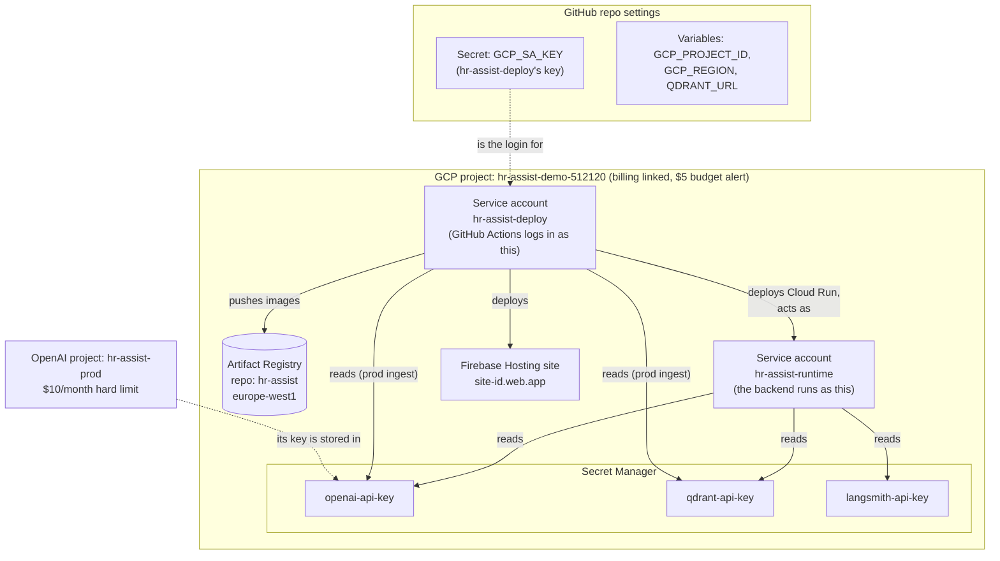

# One-time cloud setup (ticket #33)

This guide walks you through creating everything the deploy and ingest workflows need: a Google Cloud project, two service accounts, the secrets, an OpenAI prod project and Firebase Hosting. You run every command yourself. Each step says **what** it does, **why** we need it, and how to **check** it worked.

It takes about 45 minutes, and every step is free. The [deployment guide](deployment.md) explains how these pieces are used once they exist. Read its sections 1, 2 and 7 first if any of the terms here are new to you.

## What you'll have at the end



Two service accounts keep the jobs apart. The **runtime** account can only read the three secrets, so a bug in the backend can't change the project. The **deploy** account can ship new versions, but has no other powers. Its key is the only credential stored in GitHub.

## Before you start

You need:

- the Google account that owns your personal website's GCP billing;
- access to your OpenAI, Qdrant Cloud and LangSmith accounts;
- the GitHub CLI logged in to `NaveenManjappa/hr-assist`. Check with `gh auth status`.

**Every command runs in one terminal window.** Step 0 sets shell variables that later steps use. If you open a new terminal or come back later, run step 0's variable block again first.

Lines starting with `#` are comments. You don't have to type them.

---

## Step 0: Install the tools and set the variables

**What:** install the Google Cloud CLI (`gcloud`) and the Firebase CLI (`firebase`), then log in.

**Why:** almost everything below is a `gcloud` or `firebase` command. Commands are easier to repeat and review than clicking through consoles, and they're the same commands the workflows will run later.

```sh
brew install --cask gcloud-cli
npm install -g firebase-tools

# Opens the browser to log in as you. Pick your own Google account.
gcloud auth login
firebase login
```

The **project ID** is `hr-assist-demo-512120`. Project IDs must be unique across all of Google Cloud, so the plain `hr-assist-demo` wasn't available.

```sh
# The variable block: run this again whenever you open a new terminal.
PROJECT_ID=hr-assist-demo-512120
REGION=europe-west1
REPO=NaveenManjappa/hr-assist
RUNTIME_SA=hr-assist-runtime@$PROJECT_ID.iam.gserviceaccount.com
DEPLOY_SA=hr-assist-deploy@$PROJECT_ID.iam.gserviceaccount.com
MY_EMAIL=$(gcloud config get-value account)
# Make it gcloud's default project. Fails harmlessly before step 1 creates the project.
gcloud config set project $PROJECT_ID
echo "$PROJECT_ID / $REGION / $MY_EMAIL"
```

**Check:** `gcloud --version` and `firebase --version` both print versions, and the `echo` shows your email. After step 1, `gcloud config get-value project` prints `hr-assist-demo-512120`.

## Step 1: Create the project and link billing

**What:** a new, empty GCP project, attached to the billing account you already use for your website.

**Why:** a dedicated project keeps HR Assist's costs, permissions and keys away from your website (decision D7). Cloud Run needs billing linked even to use the free tier.

```sh
gcloud projects create $PROJECT_ID --name="HR Assist demo"
gcloud config set project $PROJECT_ID

# Find your billing account ID, which looks like 0X0X0X-0X0X0X-0X0X0X.
gcloud billing accounts list
BILLING_ACCOUNT=<paste the ACCOUNT_ID>
gcloud billing projects link $PROJECT_ID --billing-account=$BILLING_ACCOUNT
```

**Check:** `gcloud billing projects describe $PROJECT_ID` shows `billingEnabled: true`.

**Check the organisation policy now.** It's the one thing that could change the plan.

```sh
gcloud projects describe $PROJECT_ID --format='value(parent.type)'
```

If this prints nothing, the project isn't in an organisation, which is normal for a personal Gmail account. Carry on.

If it prints `organization`, run the command below. If the result shows `enforce: true`, **stop**: you can't create a key. Tell me, and we'll switch to Workload Identity Federation ([ADR 0004](adr/0004-service-account-key-before-wif.md)).

```sh
gcloud resource-manager org-policies describe iam.disableServiceAccountKeyCreation \
  --project=$PROJECT_ID --effective
```

## Step 2: Add a $5 budget alert

**What:** an email to you if the project's monthly cost goes past $1, $2.50 or $5.

**Why:** Cloud Run should cost $0, so any cost at all means something is wrong, such as a runaway loop or abuse. The alert tells you early. A budget only *alerts*; it doesn't stop spending. The hard stop for the expensive part, OpenAI, is step 6.

In the console:

1. Open <https://console.cloud.google.com/billing/budgets>.
2. Select your billing account, then **Create budget**.
3. **Name:** `hr-assist-demo`. **Projects:** only `hr-assist-demo-512120`. Leave the services as all services.
4. **Amount:** specified amount, **$5**.
5. **Thresholds:** 20%, 50% and 100% of actual spend. Keep **Email alerts to billing admins** ticked.
6. Click **Finish**.

**Check:** the budget appears in the list, scoped to this one project.

## Step 3: Turn on the APIs

**What:** turn on the Google services this project will use.

**Why:** a new project starts with almost everything switched off. You only pay for what you use, but a service has to be on before you can use it at all.

```sh
gcloud services enable \
  run.googleapis.com \
  artifactregistry.googleapis.com \
  secretmanager.googleapis.com \
  iam.googleapis.com
```

| API | Used for |
| --- | --- |
| `run` | Cloud Run, which runs the backend |
| `artifactregistry` | Storing the container images |
| `secretmanager` | Storing the API keys |
| `iam` | Creating service accounts and keys |

Firebase turns on its own APIs in step 9.

**Check:** `gcloud services list --enabled` lists all four.

## Step 4: Create the image repository

**What:** a Docker repository called `hr-assist` in Artifact Registry, in `europe-west1`.

**Why:** the Deploy workflow builds a container image and pushes it here. Cloud Run then pulls it from here. Keeping it in the same region as Cloud Run makes deploys faster (decision D8).

```sh
gcloud artifacts repositories create hr-assist \
  --repository-format=docker \
  --location=$REGION \
  --description="HR Assist backend images"
```

**Check:** `gcloud artifacts repositories list --location=$REGION` shows `hr-assist`.

## Step 5: Create the two service accounts

**What:** two accounts for programs rather than people. They have no permissions yet.

**Why:** each program gets its own identity with only the access it needs. That limits the damage if one is misused.

```sh
gcloud iam service-accounts create hr-assist-runtime \
  --display-name="HR Assist backend (Cloud Run runtime)"
gcloud iam service-accounts create hr-assist-deploy \
  --display-name="HR Assist GitHub Actions deployer"
```

**Check:** `gcloud iam service-accounts list` shows both, with emails matching `$RUNTIME_SA` and `$DEPLOY_SA`.

## Step 6: Create the OpenAI prod project, with a hard spending limit

**What:** a separate OpenAI project just for the live demo, with a $10/month limit that OpenAI **enforces**, and an API key belonging to that project.

**Why:** this is the backstop. Even if our own rate limits had a bug, OpenAI stops accepting requests at $10 (decision D3). A separate project also means the demo's usage, and its key, are kept apart from your local development.

In the browser:

1. Open <https://platform.openai.com>. In the project picker at the top left, choose **Create project** and name it `hr-assist-prod`.
2. With `hr-assist-prod` selected, open **Project settings → Limits**. Under **Spend**, choose **Edit spend limit**.
3. Set the **Monthly spend limit** to **$10**, and turn on **Enforce a hard limit**. Without this switch the limit is only an email alert. Click **Save**.
4. Open **API keys** for this project, choose **Create new secret key**, and name it `hr-assist-prod`. **Copy the key now**: OpenAI shows it only once. Keep it in the clipboard or your password manager until step 8.

**Check:** the Limits page shows $10 with the hard limit on. OpenAI warns that the limit isn't applied instantly, so spending can go slightly over $10.

## Step 7: Create the prod Qdrant and LangSmith keys

**What:** new API keys used only by the live demo.

**Why:** if a key needs replacing, you can delete the prod one without breaking your local setup, and the reverse.

**Qdrant Cloud:** open <https://cloud.qdrant.io>, then your cluster → **API Keys** → **Create**. Name it `hr-assist-prod`. Ingest writes to the collection, so it needs read-write access. Copy the key.

**Also note the cluster URL.** It's the same `QDRANT_URL` as in your `.env`. It isn't secret: on its own it's useless without the key.

**LangSmith:** open <https://smith.langchain.com>, then **Settings → API Keys → Create API Key**. Describe it as `hr-assist-prod`, and copy it. Prod traces will go to a LangSmith project called `hr-assist-prod`. The deploy ticket sets that name, and LangSmith creates the project on the first trace.

## Step 8: Put the keys in Secret Manager

**What:** store the three keys as secrets, and allow the **runtime** account to read them.

**Why:** Secret Manager is the single home for the keys (decision D10). Cloud Run reads them when an instance starts, so they never appear in GitHub, in the deploy command or in the service config.

The commands below **prompt** for each key instead of having you type it in the command line. A key typed straight into a command would end up in your shell history. `read -rs` reads without echoing the input.

```sh
read -rs "OPENAI_KEY?Paste the OpenAI prod key: "; echo
printf '%s' "$OPENAI_KEY" | gcloud secrets create openai-api-key \
  --replication-policy=automatic --data-file=-
unset OPENAI_KEY

read -rs "QDRANT_KEY?Paste the Qdrant prod key: "; echo
printf '%s' "$QDRANT_KEY" | gcloud secrets create qdrant-api-key \
  --replication-policy=automatic --data-file=-
unset QDRANT_KEY

read -rs "LANGSMITH_KEY?Paste the LangSmith prod key: "; echo
printf '%s' "$LANGSMITH_KEY" | gcloud secrets create langsmith-api-key \
  --replication-policy=automatic --data-file=-
unset LANGSMITH_KEY
```

`printf '%s'` avoids adding a trailing newline to the key, which would break the login.

Now allow the runtime account to read each secret. Access is granted **per secret**, not across the whole project.

```sh
for SECRET in openai-api-key qdrant-api-key langsmith-api-key; do
  gcloud secrets add-iam-policy-binding $SECRET \
    --member="serviceAccount:$RUNTIME_SA" \
    --role=roles/secretmanager.secretAccessor
done
```

**Check:** `gcloud secrets list` shows three secrets. `gcloud secrets versions access latest --secret=qdrant-api-key | head -c 4; echo` prints the first four characters of the key, which you can compare with Qdrant's console. Don't print the whole key.

## Step 9: Add Firebase and create the Hosting site

**What:** turn the GCP project into a Firebase project, and create its Hosting site, which gives you the `<site>.web.app` address.

**Why:** Firebase Hosting serves the Angular app and forwards `/api/**` to Cloud Run (decision D2). Every Firebase project is also a GCP project, so we add Firebase to the one we just made. For projects added from mid-October 2026, Firebase doesn't create the Hosting site automatically, so we create it ourselves. The first site created becomes the default.

```sh
firebase projects:addfirebase $PROJECT_ID

# The site ID becomes the address: <site-id>.web.app. Use the project ID if it's free.
firebase hosting:sites:create $PROJECT_ID --project $PROJECT_ID
firebase hosting:sites:list --project $PROJECT_ID
```

If the site ID is taken, choose another, e.g. `hr-assist-nm`. Write down the site ID you end up with.

**Check:** `hosting:sites:list` shows your site with its `https://<site-id>.web.app` URL. Opening that URL now shows a Firebase placeholder page, which is fine until the first deploy.

## Step 10: Give the deploy account its permissions

**What:** grant the **deploy** account exactly what the Deploy and Ingest workflows need.

**Why:** if its key ever leaks, this list is everything an attacker could do, so it's kept short and limited to this project (ADR 0004).

```sh
# Deploy and update the Cloud Run service, including allowing public access.
gcloud projects add-iam-policy-binding $PROJECT_ID \
  --member="serviceAccount:$DEPLOY_SA" --role=roles/run.admin

# Deploy the Angular app to Firebase Hosting.
gcloud projects add-iam-policy-binding $PROJECT_ID \
  --member="serviceAccount:$DEPLOY_SA" --role=roles/firebasehosting.admin

# The Firebase CLI reads the project's API key list when it deploys.
gcloud projects add-iam-policy-binding $PROJECT_ID \
  --member="serviceAccount:$DEPLOY_SA" --role=roles/serviceusage.apiKeysViewer

# Push images to this one repository, and no other.
gcloud artifacts repositories add-iam-policy-binding hr-assist --location=$REGION \
  --member="serviceAccount:$DEPLOY_SA" --role=roles/artifactregistry.writer

# Deploy Cloud Run "as" the runtime account. Without this, it can't attach that identity.
gcloud iam service-accounts add-iam-policy-binding $RUNTIME_SA \
  --member="serviceAccount:$DEPLOY_SA" --role=roles/iam.serviceAccountUser

# The prod ingest workflow reads the OpenAI and Qdrant keys. It doesn't need LangSmith's.
for SECRET in openai-api-key qdrant-api-key; do
  gcloud secrets add-iam-policy-binding $SECRET \
    --member="serviceAccount:$DEPLOY_SA" --role=roles/secretmanager.secretAccessor
done
```

| Role | Granted on | Why the deploy account needs it |
| --- | --- | --- |
| `run.admin` | project | Create and update `hr-assist-api`, and allow unauthenticated calls, which Firebase rewrites need |
| `firebasehosting.admin` | project | Deploy the site and its rewrite rules |
| `serviceusage.apiKeysViewer` | project | Firebase's deploy action lists it as needed for CLI deploys |
| `artifactregistry.writer` | the `hr-assist` repo only | Push new images |
| `iam.serviceAccountUser` | the runtime account only | Run the service as `hr-assist-runtime` |
| `secretmanager.secretAccessor` | two secrets only | The prod ingest workflow |

Firebase's documentation also mentions `firebaseauth.admin`. That role is only for preview channels, and we deploy straight to the live channel, so it's left out.

**Check all six.** Each line should print the role named in its comment. An empty line means that grant didn't take effect, so run its command again. A grant that silently fails here only shows up later, as a failed deploy (see [the log of fixes](#log-of-fixes-made-after-setup)).

```sh
# Project level: expect run.admin, firebasehosting.admin and serviceusage.apiKeysViewer
gcloud projects get-iam-policy $PROJECT_ID \
  --flatten="bindings[].members" \
  --filter="bindings.members:$DEPLOY_SA" --format="value(bindings.role)"

# The image repository: expect roles/artifactregistry.writer
gcloud artifacts repositories get-iam-policy hr-assist --location=$REGION \
  --flatten="bindings[].members" \
  --filter="bindings.members:$DEPLOY_SA" --format="value(bindings.role)"

# The runtime account: expect roles/iam.serviceAccountUser
gcloud iam service-accounts get-iam-policy $RUNTIME_SA \
  --flatten="bindings[].members" \
  --filter="bindings.members:$DEPLOY_SA" --format="value(bindings.role)"

# The two secrets: expect roles/secretmanager.secretAccessor twice
for SECRET in openai-api-key qdrant-api-key; do
  gcloud secrets get-iam-policy $SECRET \
    --flatten="bindings[].members" \
    --filter="bindings.members:$DEPLOY_SA" --format="value(bindings.role)"
done
```

## Step 11: Create the deploy key and store it in GitHub

**What:** a JSON key file for the deploy account, saved as the GitHub secret `GCP_SA_KEY`, then deleted from your laptop.

**Why:** this is how GitHub Actions logs in to Google (decision D5). Treat the file like a password: it never expires on its own, and anyone holding it can do everything step 10 allows.

```sh
KEY_FILE=~/hr-assist-deploy-key.json
gcloud iam service-accounts keys create $KEY_FILE --iam-account=$DEPLOY_SA

# Store it as one line. GitHub only hides secrets in logs line by line.
jq -c . $KEY_FILE | gh secret set GCP_SA_KEY --repo $REPO
```

**Check that the key works before deleting it.** Log in *as the deploy account* and try what the workflows will do:

```sh
gcloud auth activate-service-account --key-file=$KEY_FILE

gcloud secrets versions access latest --secret=qdrant-api-key \
  --account=$DEPLOY_SA --project=$PROJECT_ID > /dev/null && echo "secrets: ok"
gcloud artifacts repositories describe hr-assist --location=$REGION \
  --account=$DEPLOY_SA --project=$PROJECT_ID > /dev/null && echo "registry: ok"

# This one should FAIL with PERMISSION_DENIED. The deploy account was never given the
# LangSmith key, so the failure proves its access is as narrow as intended.
gcloud secrets versions access latest --secret=langsmith-api-key \
  --account=$DEPLOY_SA --project=$PROJECT_ID > /dev/null || echo "langsmith blocked: ok (expected)"
```

Then switch back to your own account and remove every local copy of the key:

```sh
gcloud auth revoke $DEPLOY_SA
gcloud config set account $MY_EMAIL
rm $KEY_FILE
```

`revoke` only removes the key from your laptop's `gcloud`. The key itself stays valid for GitHub.

**Check:** `gh secret list --repo $REPO` shows `GCP_SA_KEY`, `ls ~/hr-assist-deploy-key.json` says no such file, and `gcloud config get-value account` is your email again.

Set a reminder 90 days from today to rotate the key. Rotating means repeating this step, then deleting the old key with `gcloud iam service-accounts keys list --iam-account=$DEPLOY_SA` followed by `... keys delete <KEY_ID>`.

## Step 12: Set the GitHub variables

**What:** values the workflows need that aren't secret.

**Why:** they could go straight into the workflow files, but as variables they can change without a code change, and they show plainly in the repo settings.

```sh
gh variable set GCP_PROJECT_ID --repo $REPO --body "$PROJECT_ID"
gh variable set GCP_REGION     --repo $REPO --body "$REGION"
gh variable set QDRANT_URL     --repo $REPO --body "<your cluster URL from .env>"
```

`QDRANT_URL` isn't on the ticket's original list. The deploy needs it as a plain env var, and a repo variable is the natural place for it. Leave `API_URL` alone for now: that's set at go-live (#31).

**Check:** `gh variable list --repo $REPO` shows the three variables.

## Step 13: Record the result and close the ticket

Post the non-secret facts on #33 so the next tickets can use them. **Never paste a key.**

```sh
SITE_ID=<your site ID from step 9>
gh issue comment 33 --repo $REPO --body "Setup done.
- Project: \`$PROJECT_ID\`, region \`$REGION\`
- Artifact Registry: \`$REGION-docker.pkg.dev/$PROJECT_ID/hr-assist\`
- Runtime SA: \`$RUNTIME_SA\`
- Deploy SA: \`$DEPLOY_SA\` (key in \`GCP_SA_KEY\`, created $(date +%F), rotate by $(date -v+90d +%F))
- Secrets: \`openai-api-key\`, \`qdrant-api-key\`, \`langsmith-api-key\`
- Firebase Hosting site: https://$SITE_ID.web.app
- OpenAI project \`hr-assist-prod\`: \$10/month hard limit on
- Repo variables: GCP_PROJECT_ID, GCP_REGION, QDRANT_URL"
gh issue close 33 --repo $REPO
```

## Final checklist (matches #33's acceptance criteria)

- [ ] `gcloud` and `firebase` installed and logged in (step 0)
- [ ] Project created, billing linked, no organisation policy blocking keys (step 1)
- [ ] $5 budget alert on this project only (step 2)
- [ ] Cloud Run, Artifact Registry, Secret Manager and IAM APIs on (step 3)
- [ ] `hr-assist` Docker repository in `europe-west1` (step 4)
- [ ] Runtime and deploy service accounts (step 5)
- [ ] OpenAI `hr-assist-prod` project with the $10 **hard** limit, and its key (step 6)
- [ ] Prod Qdrant and LangSmith keys (step 7)
- [ ] Three secrets in Secret Manager, readable by the runtime account (step 8)
- [ ] Firebase added, and the Hosting site created (step 9)
- [ ] Deploy account roles granted (step 10)
- [ ] `GCP_SA_KEY` in GitHub, key checked, local file deleted (step 11)
- [ ] `GCP_PROJECT_ID`, `GCP_REGION` and `QDRANT_URL` variables set (step 12)
- [ ] Comment posted on #33 and the issue closed (step 13)

## If something goes wrong

| Message | What it means | Fix |
| --- | --- | --- |
| `The project ID you specified is already in use` | Project IDs are unique across all of Google Cloud | Pick another, e.g. `hr-assist-demo-nm`, and update `PROJECT_ID` and the two `_SA` variables in step 0 |
| `Billing account ... not found` or `permission denied` on link | Wrong account ID, or your user isn't a billing admin | Recheck `gcloud billing accounts list`. Link it in the console under Billing → My projects |
| `API [...] not enabled` | Step 3 was skipped, or hasn't finished yet | Run step 3 again, and wait a minute |
| `Key creation is not allowed on this service account` | An organisation policy blocks keys | Stop and switch to WIF (ADR 0004) |
| `firebase: command not found` | npm's global bin folder isn't on your `PATH` | Open a new terminal, or run `npx firebase-tools ...` |
| `Site ID ... is already taken` | Hosting site IDs are global | Choose another site ID in step 9 |
| The Deploy workflow fails at **Build and push the backend image** with `Permission 'artifactregistry.repositories.uploadArtifacts' denied` | The deploy account isn't a writer on the `hr-assist` repository: step 10's grant didn't take effect | Run step 10's `artifacts repositories add-iam-policy-binding` command again, check it with step 10's checks, then rerun the failed Deploy run |
| The Deploy workflow fails at **Deploy Firebase Hosting** with a permission error | Usually `serviceusage.apiKeysViewer` is missing from the deploy account | Run step 10's `apiKeysViewer` command again, then rerun the failed Deploy run |
| A later deploy fails with `serviceusage.services.use` | The deploy account also needs to "use" the project's services | `gcloud projects add-iam-policy-binding $PROJECT_ID --member="serviceAccount:$DEPLOY_SA" --role=roles/serviceusage.serviceUsageConsumer` |
| You pasted a key somewhere public | Treat it as leaked | Delete it at its source (GCP IAM, OpenAI, Qdrant or LangSmith) and make a new one. For a GCP key, repeat step 11 |

## Log of fixes made after setup

When something in the cloud is fixed by hand, add a row here: what broke, why, and what was changed. This way the project's real state never drifts away from what this guide says without a record.

| Date | What broke | Cause | What was changed |
| --- | --- | --- | --- |
| 2026-10-20 | The first Deploy run (#29) failed at **Build and push the backend image**: `artifactregistry.repositories.uploadArtifacts denied` | Two of step 10's grants never took effect: `artifactregistry.writer` on the `hr-assist` repository, and `serviceusage.apiKeysViewer` on the project. The rest of step 10 was in place. | Both roles granted to `hr-assist-deploy` with step 10's commands, and step 10 now checks all six grants. The failed Deploy run was rerun. |
| 2026-10-20 | The rerun deployed the backend, then failed at **Check the revision serving all traffic runs this commit's image** | A bug in the workflow, not the cloud: Cloud Run records the image by digest (`…@sha256:…`), and the check compared it with the tag (`…:<commit SHA>`). The live revision did run the right image. | The check now looks up the tag's digest in Artifact Registry and compares digests. The fix went through a PR and deployed itself. |

## Sources

- Google Cloud CLI: [Install](https://docs.cloud.google.com/sdk/docs/install-sdk). The Homebrew cask is `gcloud-cli`.
- Cloud Run: [Configure secrets](https://docs.cloud.google.com/run/docs/configuring/services/secrets), covering the runtime identity needing `roles/secretmanager.secretAccessor`.
- IAM: [Best practices for managing service account keys](https://docs.cloud.google.com/iam/docs/best-practices-for-managing-service-account-keys), covering keys not expiring, rotation and the organisation-policy default.
- GitHub Action auth: [google-github-actions/auth](https://github.com/google-github-actions/auth), covering storing the key JSON as a single line.
- Firebase: [Service account roles for Hosting deploys](https://github.com/FirebaseExtended/action-hosting-deploy/blob/main/docs/service-account.md), covering `firebasehosting.admin`, `run.viewer` for Cloud Run rewrites (covered by `run.admin`), `serviceusage.apiKeysViewer`, and `firebaseauth.admin` for preview channels only.
- Firebase: [Understand the default Hosting site](https://firebase.google.com/docs/hosting/default-site), covering on-demand creation for projects added after 15 October 2026 and `firebase hosting:sites:create`.
- OpenAI: [Spend limits](https://developers.openai.com/api/docs/guides/spend-limits.md), covering **Enforce a hard limit**.
