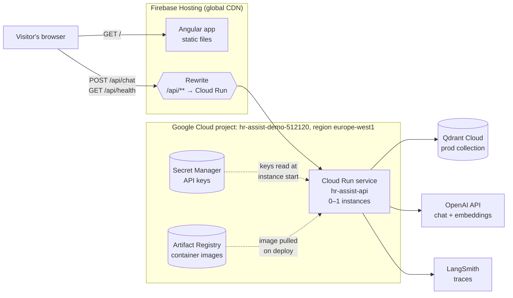
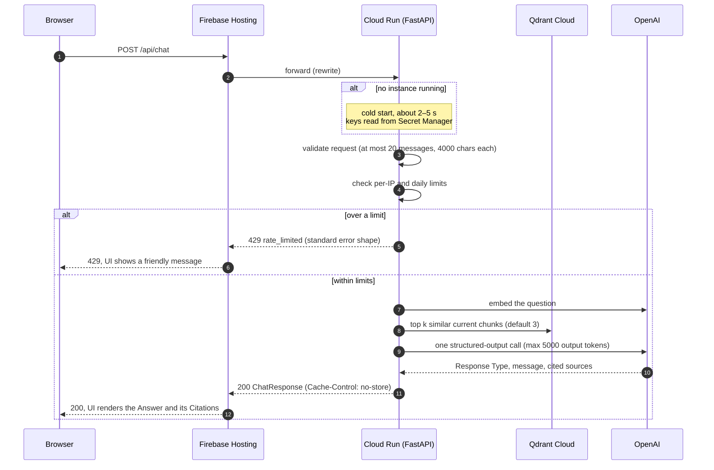
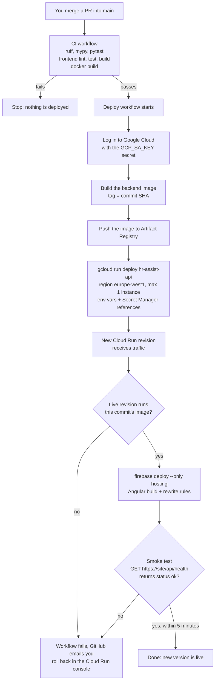
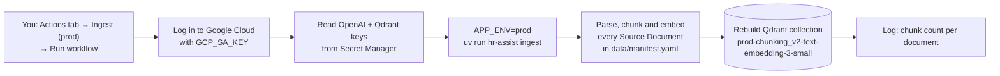
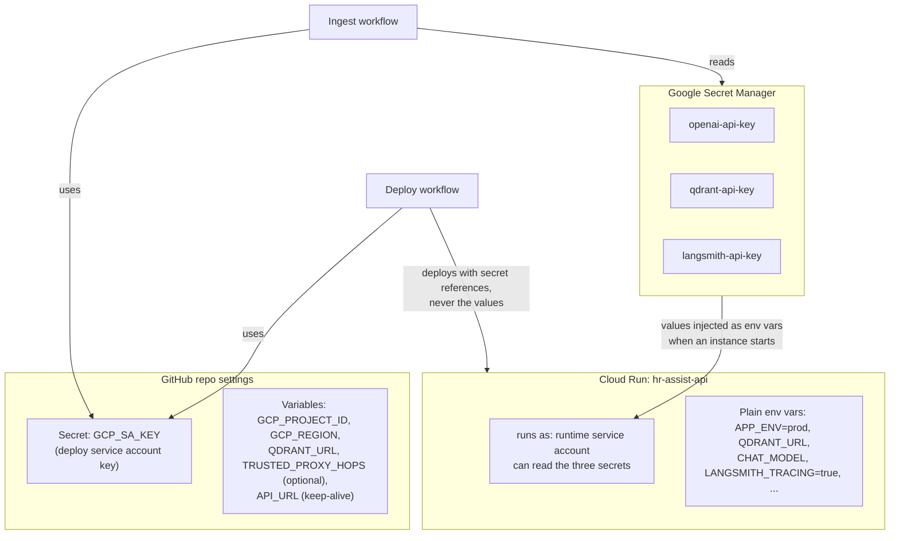
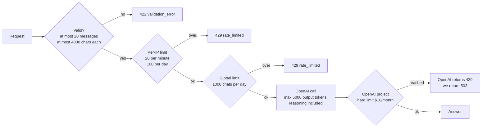

# Deploying HR Assist

This guide explains how HR Assist runs on the internet, how a new version gets deployed, and why each choice was made. It assumes you have never deployed a web app before.

> **Status:** this guide describes what is live. The Deploy workflow ([deploy.yml](../.github/workflows/deploy.yml)) puts every merge to `main` live on <https://hr-assist.naveenmanjappa.com>, and the Firebase address <https://hr-assist-demo.web.app> serves the same site. When you change the setup, update the guide in the same PR, so it always describes what is actually running.

## Contents

1. [The big picture](#1-the-big-picture)
2. [Words you'll meet](#2-words-youll-meet)
3. [How it fits together](#3-how-it-fits-together)
4. [What happens when someone asks a question](#4-what-happens-when-someone-asks-a-question)
5. [How a new version gets deployed](#5-how-a-new-version-gets-deployed)
6. [How the Corpus gets into production](#6-how-the-corpus-gets-into-production)
7. [Where the secrets live](#7-where-the-secrets-live)
8. [How we stop the demo costing money](#8-how-we-stop-the-demo-costing-money)
9. [Decision log](#9-decision-log)
10. [What you do and what's automated](#10-what-you-do-and-whats-automated)
11. [Connecting your own subdomain (GoDaddy or Namecheap)](#11-connecting-your-own-subdomain-godaddy-or-namecheap)
12. [Costs and platform limits](#12-costs-and-platform-limits)
13. [Troubleshooting](#13-troubleshooting)
14. [Sources](#14-sources)

## 1. The big picture

HR Assist has three parts that run in three places:

- The **Angular app** (the web page) is a bundle of static files: HTML, JavaScript and CSS. **Firebase Hosting** stores them and serves them from data centres around the world.
- The **FastAPI backend** runs as a container on **Google Cloud Run**. It starts when requests arrive and shuts down when nobody is using it.
- **Qdrant Cloud**, where the Corpus already lives, and **OpenAI**, which provides the models, are outside services. The backend calls them.

The browser only ever talks to one address. Firebase Hosting answers requests for the page itself and passes every request starting with `/api/` on to Cloud Run. To the browser, the page and the API come from the same site.

Deploying is automatic. When a change is merged into `main` and the tests pass, GitHub Actions builds the backend, deploys both parts, and checks that the live site is healthy.

## 2. Words you'll meet

| Term | What it means here |
| --- | --- |
| **Container image** | A packaged, runnable copy of the backend: Python, our code and its libraries, all in one file. It's built from a recipe called a **Dockerfile**. The same image runs on your laptop and in the cloud. |
| **Artifact Registry** | Google's storage for container images. CI uploads each new image here, and Cloud Run pulls it from here. |
| **Cloud Run service** | Google's name for "run this container and give it a URL". We have one service, `hr-assist-api`. |
| **Revision** | Each deploy creates a new, unchangeable revision of the service. Cloud Run sends traffic to the newest healthy one, so going back means pointing traffic at an older revision. |
| **Instance** | A running copy of the container. Cloud Run starts instances when requests arrive and stops them when idle. We allow at most one. |
| **Cold start** | The few seconds it takes to start an instance when none is running. The first visitor after a quiet period waits for it. |
| **Firebase Hosting** | A service that serves static files from a global network of servers, called a **CDN**, with free HTTPS. |
| **Rewrite** | A Firebase Hosting rule: "send requests for `/api/**` to the Cloud Run service". The browser never sees the Cloud Run address. |
| **Origin** | A site's scheme, host and port, e.g. `https://hr-assist.example.com`. Browsers restrict calls between different origins (**CORS**). Because of the rewrite, we only ever have one origin. |
| **Secret Manager** | Google's safe for passwords and API keys. Cloud Run reads the keys from it when an instance starts. |
| **Service account** | A Google account for a program rather than a person. We have two: one that the backend runs as, and one that GitHub Actions deploys with. |
| **Service account key** | A JSON file that lets a program log in as a service account. It works like a password, and it never expires on its own. |
| **GitHub Actions workflow** | A YAML file in `.github/workflows/` that GitHub runs on a trigger: a push, a schedule, or a button click. |
| **GitHub secret / variable** | Values stored in the repo settings and given to workflows. **Secrets** are hidden in logs. **Variables** are not, so they're for non-sensitive values. |
| **Smoke test** | A quick check after deploying ("does `/api/health` say ok?") that catches a broken deploy straight away. |

## 3. How it fits together



Why the web page and the API sit on different services:

- **The page loads instantly, even when the backend is asleep.** Firebase serves the Angular files from a CDN, which never has a cold start. The connection-status indicator shows the backend waking up instead of a blank screen.
- **No CORS in production.** The production build calls the API at a relative path (`apiBaseUrl: ''` in [environment.ts](../frontend/src/environments/environment.ts)), and the rewrite makes that work.

The rewrite lives in [firebase.json](../firebase.json): `/api/**` goes to Cloud Run service `hr-assist-api` in `europe-west1`, and every other path falls back to `index.html` so the Angular app handles it. `index.html` is served with `Cache-Control: no-cache`, so a visitor always gets the newest bundle after a deploy. The other files have hashed names, so Firebase's default caching is safe for them.

## 4. What happens when someone asks a question



Firebase Hosting gives each request at most **60 seconds**. A chat reply takes a few seconds, so that's plenty. A request that takes longer gets a `504`.

## 5. How a new version gets deployed

Two workflows run in a chain: **CI** ([ci.yml](../.github/workflows/ci.yml)), then **Deploy** ([deploy.yml](../.github/workflows/deploy.yml)), which only starts when CI succeeds for a push to `main`. A failed or cancelled CI run deploys nothing.



What triggers what:

| Trigger | Workflow | What it does |
| --- | --- | --- |
| Pull request opened or updated | CI | Runs the checks and builds the Docker image, but deploys nothing |
| Push to `main` | CI, then Deploy | Checks, then deploys both parts and runs the smoke test |
| You click **Run workflow** | Ingest (prod) | Rebuilds the prod Qdrant collection (see section 6) |
| Twice a week, on a schedule | Qdrant keep-alive | Calls `/api/health` so the free Qdrant cluster isn't suspended |

What the Deploy workflow sets on the service, on every deploy:

| Setting | Value |
| --- | --- |
| Image | `europe-west1-docker.pkg.dev/hr-assist-demo-512120/hr-assist/hr-assist-api:<commit SHA>` |
| Instances | min 0, max 1 |
| Access | unauthenticated invocation allowed (Firebase rewrites need it) |
| Runs as | `hr-assist-runtime@hr-assist-demo-512120.iam.gserviceaccount.com` |
| Plain env vars | `APP_ENV=prod`, `QDRANT_URL` (repo variable), `CHAT_MODEL`, `EMBEDDING_MODEL`, `LANGSMITH_TRACING=true`, `LANGSMITH_PROJECT=hr-assist-prod`, `FRONTEND_ORIGIN=https://hr-assist.naveenmanjappa.com`, `TRUSTED_PROXY_HOPS` (repo variable, default `1`) |
| Secrets | `OPENAI_API_KEY`, `QDRANT_API_KEY` and `LANGSMITH_API_KEY`, as references to the `latest` version in Secret Manager |

`--set-env-vars` replaces the whole list on each deploy, so a variable added by hand in the console disappears on the next merge. Change the workflow instead.

**Serialised deploys.** Deploy runs in a single concurrency group without cancelling. If a second merge lands mid-deploy, its deploy waits for the first to finish. If several merges pile up, GitHub keeps only the newest waiting run, so `main`'s latest commit is what ends up live. CI itself cancels a superseded run on `main`, and a cancelled CI run triggers no deploy.

**The smoke test** is [scripts/smoke-test.sh](../scripts/smoke-test.sh). It calls `GET https://hr-assist.naveenmanjappa.com/api/health` every 10 seconds for up to 5 minutes, which covers a cold start, and passes only on `"status": "ok"`. A `degraded` reply (Qdrant down), an error status or no answer at all keeps it retrying until the window closes, then fails the workflow. You can run it yourself against any URL, for example `scripts/smoke-test.sh http://localhost:8000 30`. It sends no chat, so a deploy costs no tokens and uses none of the quota.

**Rolling back.** These steps were checked against both consoles on 2026-10-20. Cloud Run keeps every revision. If a deploy is bad, open Cloud Run → `hr-assist-api` → Revisions → **Manage traffic**, and send 100% to the previous revision. That pin lasts until the next merge: every deploy sends 100% of traffic to the newest revision again, and then checks that the revision serving it runs the merged commit's image. So fix or revert on `main` before merging anything else. Firebase Hosting has its own release history with a **Rollback** button. You can also revert the commit on `main` and let the pipeline deploy again.

## 6. How the Corpus gets into production

Ingestion is slow, costs a little in embeddings and only needs to run when the documents or chunking change, so it is **a button, not part of every deploy**: the **Ingest (prod)** workflow ([ingest-prod.yml](../.github/workflows/ingest-prod.yml)). It can only be started by hand.

**How to run it.** On GitHub, open **Actions** → **Ingest (prod)** → **Run workflow**, leave the branch as `main`, and click the green **Run workflow** button. From a terminal: `gh workflow run ingest-prod.yml`, then `gh run watch` to follow it. It takes a few minutes.



**When to run it.**

- **Once before going live.** Until it has run, the `prod-…` collection doesn't exist, and every chat fails with `503 upstream_unavailable` ("Searching the policy index failed."), while `/api/health` still says ok.
- **Again after changing** `data/manifest.yaml`, the documents or the chunking.

**How to check it worked.** The log ends with one line per Source Document, then `Rebuilt prod-chunking_v2-text-embedding-3-small with 408 chunks`. That total matches the local dev collection on 2026-10-26. A different total means the documents or chunking changed, which is only expected if you changed them. Then ask the smoke question in the live app: "How much annual leave do I get after 4 years?"

**Details.**

- Prod shares the free Qdrant cluster with dev. The collection name starts with `APP_ENV`, so `prod-…` and your local `development-…` never collide, and the workflow never touches the dev collection.
- The OpenAI and Qdrant keys are read from Secret Manager inside the one step that uses them, and masked first, so they never appear in the log. The OpenAI key is the prod project's, so the embedding cost counts against its $10 limit.
- During the rebuild, which takes about a minute, the live demo may answer badly or fail. That's acceptable for a demo.
- The PDF and PPTX parsing libraries are only installed in this workflow, never in the serving container. That keeps the container small and cold starts fast.

## 7. Where the secrets live

Every key lives in **one** place, Secret Manager, except the one key that's needed to reach Secret Manager.



- **Nothing changes in the backend code.** `Settings` in [settings.py](../backend/src/hr_assist/settings.py) already reads environment variables, and it ignores a missing `.env` file.
- **Changing a key.** Add a new version of the secret in Secret Manager, then redeploy, or deploy a new revision from the console. Running instances keep the old value until they restart, because env vars are read when an instance starts.
- **`QDRANT_URL` isn't secret.** On its own it's useless without the API key, so it's a plain env var.
- **The one key in GitHub** belongs to the deploy service account, which can only deploy this one project. See [ADR 0004](adr/0004-service-account-key-before-wif.md) for why it's a key for now and how to remove it later.

## 8. How we stop the demo costing money

The demo is public with no login, and every question costs OpenAI tokens. There are several layers of protection, from the code outwards. The in-app layers (request validation, rate limits and the output cap) are in the code. The OpenAI hard limit and the GCP budget alert were set up by hand, in steps 2 and 6 of the [one-time setup guide](deployment-setup.md).



Outside the app, two more things watch spending:

- **A GCP budget alert at $5/month** emails you if Cloud Run or anything else in the project starts costing money.
- **The OpenAI hard limit** is enforced by OpenAI itself, so it holds even if our own limits have a bug. You have to turn on **Enforce a hard limit** in the project's settings, otherwise it's only an alert. OpenAI warns that enforcement isn't instantaneous, so spending can slightly exceed it.

What a request costs: one chat sends about 5,000 input tokens (8 chunks) and returns a few hundred output tokens. That's roughly $0.001 on `gpt-6-luna`, so even the 1000-a-day cap costs about $1 a day at most.

**Bots that find the Cloud Run URL.** Cloud Run gives the service a public `https://hr-assist-api-….run.app` address. Firebase Hosting can only forward requests to a publicly reachable service, and Google's docs say that restricting ingress or turning off that URL breaks Firebase rewrites. So someone could call the backend directly and bypass Firebase. This is acceptable for Stage 2 because the limits above live **inside the app**, so every path hits them. The worst a bot can do is use up the day's quota until midnight UTC. A stronger fix, **Firebase App Check**, is left for Stage 5 (see decision D9).

**Why exactly one instance.** The rate-limit counters live in the instance's memory. With two instances each would count separately, and a visitor could make 40 requests a minute. Capping Cloud Run at one instance keeps the counts correct. Google notes the cap "can be exceeded for a brief period", for example during a deploy, which is fine for a demo. One instance can handle up to 80 requests at once, and our handlers are async, so one is enough. When the instance restarts, the counters reset. The limits are settings (`RATE_LIMIT_PER_MINUTE`, `RATE_LIMIT_PER_DAY`, `RATE_LIMIT_GLOBAL_PER_DAY`), and a rejection's `Retry-After` header says how many seconds until the window resets.

**Which IP counts.** The client IP is read from `X-Forwarded-For`, counting `TRUSTED_PROXY_HOPS` entries from the right (default `1`). Each proxy appends the address it received the request from, so entries further left were written by the client and are ignored. Without the header, the socket peer is used. The Deploy workflow passes the `TRUSTED_PROXY_HOPS` repo variable through, or `1` if it isn't set.

Every chat logs the evidence in one line from `hr_assist.rate_limit`: the raw header, the socket peer, the hop count and the client it chose, e.g. `X-Forwarded-For='198.51.100.4' peer=169.254.1.1 hops=1 client=198.51.100.4`. Find them in Cloud Run → `hr-assist-api` → Logs, filtered on `X-Forwarded-For`. This means Cloud Run's logs hold each visitor's IP address, kept for Cloud Logging's default 30 days. The privacy notice already says questions are logged.

**`X-Forwarded-For` on each path.** Measured on 2026-10-20, with one chat through each path from a machine whose IP was known. To measure again, for example if Google changes its proxies, send one chat through each path and read the two log lines:

```sh
ASK='{"messages":[{"role":"user","content":"How much annual leave do I get?"}]}'
curl -s -X POST https://hr-assist-demo.web.app/api/chat -H 'Content-Type: application/json' -d "$ASK" > /dev/null
RUN_URL=$(gcloud run services describe hr-assist-api --region europe-west1 --format 'value(status.url)')
curl -s -X POST "$RUN_URL/api/chat" -H 'Content-Type: application/json' -d "$ASK" > /dev/null
```

| Path | Raw `X-Forwarded-For` | Position of your IP from the right |
| --- | --- | --- |
| Firebase (`web.app`) | `<visitor IP>,66.249.93.x` | 2nd. The last entry is a Google proxy, and it changes from request to request. |
| Direct (`run.app`) | `<visitor IP>` | 1st |

So **`TRUSTED_PROXY_HOPS` is `2`**, set as a repo variable. The paths disagree, and the Firebase setting wins, because it keeps real visitors in separate buckets. With `1`, every Firebase visitor would be counted against Google's proxy addresses and share their limits.

On the direct path, an honest caller's header has only one entry. The limiter then falls back to that entry, so honest callers are still counted correctly. A caller who adds a forged entry of their own gets that entry counted instead, and so can dodge the per-IP limits on that path. Only the global daily cap and the OpenAI hard limit hold there, as decision D9 accepts.

To change the setting: `gh variable set TRUSTED_PROXY_HOPS --body <n>`, then rerun the latest Deploy run. Check both by sending 21 chats in a minute through each URL: the 21st must get a 429.

## 9. Decision log

Each decision gives the choice, why it suits this project, what else we considered, what it costs us, and how to check it's working. The two hardest to reverse also have ADRs.

### D1. Google Cloud Run for the backend

- **Decision:** run the FastAPI container on Cloud Run, scaling to zero, in a new GCP project.
- **Rationale:** your existing GCP account and billing can be reused. It costs nothing at demo traffic: the monthly free tier is 180,000 vCPU-seconds, 360,000 GiB-seconds and 2 million requests. And a slim Python container wakes in a few seconds.
- **Alternatives:** Render's free tier (sleeps after 15 minutes and takes about 50s to wake); Fly.io or Railway (no free tier, about $2–5/month); Hugging Face Spaces (free, but less professional).
- **Trade-offs:** a GCP billing account is required, so a budget alert is essential. The first visitor after a quiet period waits for a cold start.
- **Validation:** the GCP billing report shows $0. Time the first `/api/health` call after an hour idle: expect under about 5s.

### D2. Firebase Hosting in front, with a same-origin rewrite

- **Decision:** serve the Angular build from Firebase Hosting, and rewrite `/api/**` to Cloud Run. See [ADR 0003](adr/0003-cloud-run-behind-firebase-hosting.md).
- **Rationale:** the UI loads instantly even when the backend is cold. Production needs no CORS, and the frontend already calls a relative `/api` path. Firebase forwards to Cloud Run natively.
- **Alternatives:** one container where FastAPI also serves the Angular files (simplest, but a cold start blocks the page itself); split hosting with cross-origin calls and CORS.
- **Trade-offs:** two deploy targets. Requests are capped at 60 seconds. Cookies are stripped except one named `__session`, which doesn't matter because we use none.
- **Validation:** load the site while the backend is asleep, and the page appears straight away. `curl https://<site>/api/health` through Firebase returns ok.

### D3. Usage protection: layered limits, no login

- **Decision:** a hard limit of $10/month on a separate OpenAI prod project; 10 requests/min and 100/day per IP; 1000 chats/day globally; at most 20 messages per request; 5000 output tokens at most, reasoning tokens included (raised from 800 when the chat model's reasoning effort was set to low); a $5 GCP budget alert.
- **Rationale:** recruiters can try the demo without signing up, and the worst-case bill stays small.
- **Alternatives:** a login or CAPTCHA (more friction); an API gateway or Cloud Armor (costs money); platform-level limits only.
- **Trade-offs:** in-memory counters need a single instance and reset on restart. The client IP has to be read correctly from `X-Forwarded-For` behind Firebase and Google's front end, without trusting a header a client could fake.
- **Validation:** tests that the 21st request in a minute gets a 429 and a 21-message request gets a 422; a test that a forged `X-Forwarded-For` header can't get around the limit; the OpenAI dashboard shows the hard limit turned on.

### D4. Prod Corpus loaded by a manual workflow

- **Decision:** a `workflow_dispatch` GitHub Actions workflow runs `hr-assist ingest` with `APP_ENV=prod`. The Test Fixture stays out.
- **Rationale:** it's repeatable and leaves a log, prod keys never go on your laptop, and the serving image stays free of PDF libraries.
- **Alternatives:** run the ingest locally with prod keys; ingest when the container starts (slow cold starts and repeated embedding costs).
- **Trade-offs:** the collection is dropped and rebuilt, so the demo has a minute of downtime.
- **Validation:** the workflow log shows a chunk count for each document. Afterwards the smoke question ("How much annual leave do I get after 4 years?") returns an Answer with Citations.

### D5. CI-gated automatic deploys, logged in with a service account key

- **Decision:** a push to `main` runs CI, and only if it passes does the Deploy workflow build, deploy and smoke-test. GitHub logs in to Google with a service account JSON key stored as the `GCP_SA_KEY` secret. See [ADR 0004](adr/0004-service-account-key-before-wif.md).
- **Rationale:** what's on `main` is always what's live, and a broken build never ships. A key is the quickest login to set up, and both `google-github-actions/auth` and Firebase's deploy action accept one.
- **Alternatives:** Workload Identity Federation, which Google recommends because there's no long-lived key; manual deploys from your laptop; the platform's own Git integration, which doesn't wait for CI.
- **Trade-offs:** the key never expires on its own. If it leaks, someone can deploy to this project until the key is deleted. Mitigations: the deploy account has the narrowest roles possible, the key only lives in GitHub, and it's rotated every 90 days.
- **Validation:** a merged change shows CI → Deploy → smoke test all green. If you break `/api/health` on a branch, the smoke test fails.

### D6. Tracing on in prod, with a notice

- **Decision:** keep LangSmith tracing on in prod, and show visitors a notice: "Questions are logged to improve this demo. Don't enter personal information."
- **Rationale:** real visitor questions are free evaluation data for Stage 3, and traces make bugs in production easy to diagnose.
- **Alternatives:** tracing off in prod; logging only metadata (Response Type, latency, chunk IDs).
- **Trade-offs:** the LangSmith free tier has a monthly trace quota. Visitors may ignore the notice.
- **Validation:** a prod question shows up in the LangSmith project, and the notice is visible when the page first loads.

### D7. A dedicated GCP project

- **Decision:** a new project, `hr-assist-demo-512120`, with Firebase added to it, on your existing billing account.
- **Rationale:** HR Assist's costs, permissions and keys are kept apart from your personal website, and it's easy to delete in one go.
- **Alternatives:** add HR Assist as a second Firebase site in your website's project.
- **Trade-offs:** one more project to look after.
- **Validation:** the deploy service account has roles only in `hr-assist-demo-512120`, and HR Assist has its own line in the billing report.

### D8. Region `europe-west1` (Belgium)

- **Decision:** deploy Cloud Run and Artifact Registry in `europe-west1`.
- **Rationale:** it's supported for Firebase rewrites, it's in Google's cheapest pricing tier, and it's close to Qdrant's London cluster, about 10ms away.
- **Alternatives:** `europe-west2` (London, next to Qdrant, but a higher pricing tier).
- **Trade-offs:** about 10ms more for each Qdrant call.
- **Validation:** `latency_ms` in the chat logs, and the retrieve step's timing in LangSmith.

### D9. Scale 0 to 1, with the public `run.app` URL accepted

- **Decision:** min-instances 0 and max-instances 1. Direct calls to the `run.app` URL are allowed, but they hit the same limits. App Check is deferred to Stage 5.
- **Rationale:** no idle cost, and the in-memory limits stay correct. The URL can't be closed without breaking Firebase rewrites.
- **Alternatives:** min-instances 1 (no cold starts, about $5–10/month); an HTTPS load balancer with Cloud Armor (about $18+/month); Firebase App Check now (stops scripted calls on every URL, but adds a frontend SDK, a backend check and a reCAPTCHA setup).
- **Trade-offs:** cold starts. A bot can use up the daily quota and block real visitors until it resets.
- **Validation:** Cloud Run metrics never show more than one instance. Calling the `run.app` URL directly 11 times in a minute gets a 429.

### D10. Secret Manager as the single home for keys

- **Decision:** the OpenAI, Qdrant and LangSmith keys live only in Secret Manager. Cloud Run receives them as env vars, and the ingest workflow reads them there.
- **Rationale:** one place to change a key, the values never sit in GitHub, and no code changes are needed.
- **Alternatives:** GitHub secrets copied into Cloud Run env vars at deploy time (duplicated, and visible in the service config); plain env vars.
- **Trade-offs:** more permissions to set up. The runtime account needs `roles/secretmanager.secretAccessor`, and so does the deploy account for the ingest workflow.
- **Validation:** `gcloud run services describe hr-assist-api` shows secret *references*, not values.

### D11. Your own subdomain, after the `web.app` URL works

- **Decision:** go live on `*.web.app` first, then connect a subdomain of your website, `hr-assist.naveenmanjappa.com`, with a CNAME record at Namecheap.
- **Rationale:** it looks credible on a CV, and the link outlives any hosting change. Firebase provides the HTTPS certificate for free.
- **Alternatives:** stay on `hr-assist-demo.web.app`.
- **Trade-offs:** a DNS record to add and keep. The certificate can take up to 24 hours, though usually only a few.
- **Validation:** `curl -I https://hr-assist.naveenmanjappa.com/api/health` returns 200 with a valid certificate.

### D12. Our own Dockerfile

- **Decision:** a multi-stage Dockerfile on a slim Python 3.13 base, installing only the runtime dependencies (`uv sync --locked --no-dev --no-group ingest`). CI builds it on every PR.
- **Rationale:** you can see exactly what's in the image and run the same image locally. Leaving out the PDF libraries means a smaller image and faster cold starts.
- **Alternatives:** `gcloud run deploy --source`, which uses Google's buildpacks with no Dockerfile.
- **Trade-offs:** one more file to maintain.
- **Validation:** check the image size (aim for under 300 MB). `docker run` locally against the dev collection should answer the smoke question. A broken Dockerfile fails CI.

## 10. What you do and what's automated

**You do these once.** The commands, explanations and checks for every step are in the [one-time setup guide](deployment-setup.md) (ticket #33).

1. Install the `gcloud` and `firebase` command-line tools.
2. Create the `hr-assist-demo-512120` GCP project on your billing account, and add a **$5 budget alert**.
3. Enable the Cloud Run, Artifact Registry, Secret Manager and IAM APIs.
4. Create an Artifact Registry repository in `europe-west1`.
5. Create the two service accounts, **runtime** and **deploy**, and give each only the roles it needs.
6. Create a JSON key for the deploy account. Save it in GitHub as the `GCP_SA_KEY` secret, as a single line, then **delete the file from your laptop**.
7. Create an OpenAI **project** for prod with a **$10 monthly limit and "Enforce a hard limit" turned on**. Create a key in that project.
8. Put the OpenAI, Qdrant and LangSmith keys in Secret Manager.
9. Add Firebase to the project.
10. Set the GitHub variables `GCP_PROJECT_ID` and `GCP_REGION`.

If GCP refuses to create a key at step 6, your account belongs to an organisation that blocks keys by default (organisations created on or after 3 May 2024). The fix is Workload Identity Federation; see ADR 0004.

**Automated after that:**

- Every PR: CI checks and a Docker build.
- Every merge to `main`: CI, then deploy, then the smoke test.
- Twice a week: the Qdrant keep-alive. Set `API_URL` to the public site URL so it goes through the Firebase rewrite too.

**You click when needed:** Actions → **Ingest (prod)** → Run workflow.

**Every 90 days:** create a new deploy key, update `GCP_SA_KEY`, and delete the old key in IAM.

## 11. Connecting your own subdomain (GoDaddy or Namecheap)

Do this after the `*.web.app` URL works.

HR Assist is live this way on `hr-assist.naveenmanjappa.com`, with the DNS at Namecheap. For the full walkthrough with checks, see the [go-live guide](go-live.md) (ticket #31). It also sets `API_URL` and asks the smoke question on the live site.

1. In the Firebase console, open **Hosting → Add custom domain** and enter the subdomain, e.g. `hr-assist.naveenmanjappa.com`.
2. Pick **Quick setup** in the **Setup mode** switch. Firebase shows one DNS record to add: a **CNAME** from the subdomain to the site's `web.app` address, e.g. `hr-assist-demo.web.app`. (**Advanced** setup, for moving a site that's already live without downtime, asks for **A** and **TXT** records instead. We didn't use it.)
3. Add the record at your DNS provider:
   - **GoDaddy:** Domain → **DNS** → **Add New Record**. Type `CNAME`, Name `hr-assist`, Value `hr-assist-demo.web.app`.
   - **Namecheap:** Domain List → **Manage** → **Advanced DNS** → **Add New Record** → **CNAME Record**. Host `hr-assist`, Target `hr-assist-demo.web.app`. In the Host field, type only `hr-assist`, not the full domain.
4. **Remove** every other record on that subdomain (`A`, `AAAA`, `TXT` or another `CNAME`). DNS doesn't let a CNAME share its name with any other record, and Firebase can't issue a certificate while they exist. Leave records for other names, such as `@` and `www`, alone.
5. Click **Verify** in Firebase. DNS usually updates within an hour (GoDaddy says up to 48 hours). The HTTPS certificate usually follows within a few hours, at most 24.
6. **Leave the CNAME record in place.** Removing it takes the site down.
7. Change `SITE_URL` in [deploy.yml](../.github/workflows/deploy.yml) to the new address. The Deploy workflow uses it as `FRONTEND_ORIGIN` and for the smoke test.

If your domain's DNS is hosted somewhere other than the registrar, for example because your personal site's host manages it, add the records there instead. Only the company running your domain's nameservers can change its records.

## 12. Costs and platform limits

| Item | Expected cost | Limit to know about |
| --- | --- | --- |
| Cloud Run | $0 within the free tier (180k vCPU-s, 360k GiB-s, 2M requests a month, per billing account) | At most 1 instance; cold start when idle |
| Artifact Registry | A few cents at most; delete old images if they pile up | |
| Firebase Hosting | $0 at demo traffic | 60 s per request; cookies stripped except `__session` |
| Secret Manager | $0 for a handful of secrets | |
| Qdrant Cloud | $0 (free cluster) | Suspended after a week idle; the keep-alive prevents that |
| OpenAI | About $0.001 per chat | Hard limit of $10/month |
| LangSmith | $0 (free tier) | Monthly trace quota |

## 13. Troubleshooting

**Reading a failed run.** Open GitHub → **Actions** → the red **Deploy** run → the step with the red ✗. The real error is usually just above `Process completed with exit code 1`. From a terminal, `gh run view <run-id> --log-failed` prints only the failing step. Once the cause is fixed, rerun the same run with **Re-run failed jobs**, or `gh run rerun <run-id> --failed`. A rerun deploys the same commit, so there's nothing to merge again.

| Symptom | Likely cause | What to check |
| --- | --- | --- |
| Page loads, status shows "connecting" for a few seconds | Cold start | Normal. If it lasts more than 30s, check the Cloud Run logs. |
| `504` from `/api/chat` | The request took over 60s (Firebase's limit) | Slow OpenAI call; look up the request in the logs by `X-Request-ID` |
| `503 upstream_unavailable` | Qdrant or OpenAI failed, or the OpenAI hard limit was reached | Qdrant cluster status; the OpenAI project's usage page |
| `429 rate_limited` | Per-IP or daily limit reached | Expected under abuse. If real visitors hit it, raise the limits. |
| Deploy fails at **Build and push the backend image** with `uploadArtifacts denied` | The deploy account can't write to the image repository | [Setup guide: if something goes wrong](deployment-setup.md#if-something-goes-wrong) |
| Deploy fails with any other `Permission ... denied` | A role from setup step 10 is missing | Run setup step 10's checks; they list all six grants. Fixes made so far are in the [log of fixes](deployment-setup.md#log-of-fixes-made-after-setup) |
| Every chat returns `503 upstream_unavailable`, "Searching the policy index failed.", but `/api/health` is ok | The prod collection hasn't been built yet | Run **Ingest (prod)** (section 6) |
| Deploy succeeded but the smoke test failed | Missing secret, wrong env var, or the rewrite isn't deployed | Cloud Run → Revisions → Logs; `firebase.json` rewrites |
| Custom domain shows a certificate error | Certificate not issued yet, or another record on the subdomain besides the CNAME | Firebase Hosting → domain status; your DNS records |
| `gcloud iam service-accounts keys create` is refused | Organisation policy blocks keys | Switch to Workload Identity Federation (ADR 0004) |

## 14. Sources

Checked on 2026-10-19.

- Firebase: [Serve dynamic content with Cloud Run](https://firebase.google.com/docs/hosting/cloud-run). Covers the supported regions (including `europe-west1`), the 60-second request timeout, `firebase.json` rewrite syntax and `pinTag`, and unauthenticated invocation.
- Firebase: [Manage cache behavior](https://firebase.google.com/docs/hosting/manage-cache). Covers dynamic content defaulting to `Cache-Control: private` and cookies being stripped except `__session`.
- Firebase: [Connect a custom domain](https://firebase.google.com/docs/hosting/custom-domain). Covers Quick and Advanced setup, the TXT and A records Advanced setup asks for, removing conflicting records, and the certificate taking up to 24 hours. Quick setup's single CNAME record is what the console showed on go-live (ticket #31).
- Firebase: [Protect custom backend resources with App Check](https://firebase.google.com/docs/app-check/web/custom-resource). The defence left for Stage 5.
- Cloud Run: [Restrict network ingress](https://docs.cloud.google.com/run/docs/securing/ingress). Covers the ingress options, and that turning off the `run.app` URL breaks Firebase Hosting.
- Cloud Run: [Configure secrets](https://docs.cloud.google.com/run/docs/configuring/services/secrets). Covers `--set-secrets` and `--update-secrets`, `roles/secretmanager.secretAccessor`, and env vars being read at instance startup.
- Cloud Run: [Maximum instances](https://docs.cloud.google.com/run/docs/configuring/max-instances). Covers the `--max` flag, and that the cap can be briefly exceeded.
- Cloud Run: [Maximum concurrent requests](https://docs.cloud.google.com/run/docs/about-concurrency). The default of 80 requests per instance.
- Cloud Run: [Pricing](https://cloud.google.com/run/pricing) and the [Google Cloud free program](https://docs.cloud.google.com/free/docs/free-cloud-features). The free tier figures.
- Google Cloud IAM: [Best practices for managing service account keys](https://docs.cloud.google.com/iam/docs/best-practices-for-managing-service-account-keys). Covers keys never expiring, rotation, and the 3 May 2024 organisation-policy default.
- GitHub: [google-github-actions/auth](https://github.com/google-github-actions/auth). Covers the `credentials_json` input, why WIF is recommended over keys, and storing the key as one line.
- GitHub: [FirebaseExtended/action-hosting-deploy](https://github.com/FirebaseExtended/action-hosting-deploy). Covers the `firebaseServiceAccount` key input and `channelId: live`.
- OpenAI: [Spend limits](https://developers.openai.com/api/docs/guides/spend-limits.md). Covers turning on "Enforce a hard limit", the `429 project_spend_limit_exceeded` error, and that enforcement isn't instantaneous.
- GoDaddy: [Add a CNAME record](https://www.godaddy.com/help/add-a-cname-record-19236), checked on 2026-10-21.
- Namecheap: [How to create a CNAME record for your domain](https://www.namecheap.com/support/knowledgebase/article.aspx/9646/2237/how-to-create-a-cname-record-for-your-domain/), checked on 2026-10-21.
