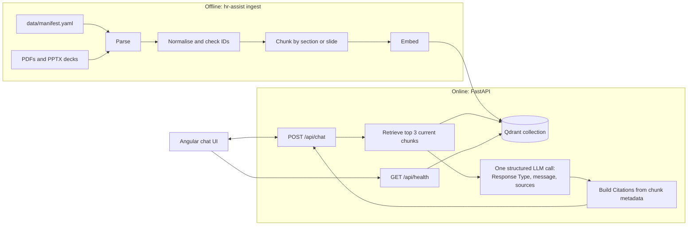

# 01. System overview

HR Assist answers Northstar Digital Services employees' HR policy questions. It is a **retrieval-augmented generation (RAG)** system: for every question it first searches a fixed set of policy documents, then asks a language model to answer using only what the search found.

**Try it:** <https://hr-assist.naveenmanjappa.com>. Questions are logged, so don't enter personal information.

## What it promises

1. **Grounded.** Every Answer comes only from the Corpus: five Policy Documents and three Summary Decks.
2. **Cited.** Each statement carries a marker such as `[1]`, and each marker points to a Citation with the document, version, section, page or slide, and the text it came from.
3. **Typed.** Every reply has one of four Response Types:

   | Response Type | When |
   | --- | --- |
   | **Answer** | The sources answer the question |
   | **Clarification** | The question has several readings that lead to different answers, so HR Assist asks which one applies |
   | **Abstention** | The Corpus doesn't cover the question. HR Assist says so and points to People Operations |
   | **Refusal** | Answering would breach privacy or confidentiality, for example a colleague's salary or health |

4. **Current.** It searches only current documents, so it answers with the rules in force today ([ADR 0007](../docs/adr/0007-search-only-current-documents.md)).
5. **Policy beats deck.** When a Summary Deck and a Policy Document disagree, it follows the Policy Document and says so.

## The parts



| Part | What it does | Code | Detail |
| --- | --- | --- | --- |
| **Corpus and manifest** | Lists every document with its ID, version, kind, status and dates | [data/](../data/), [corpus/](../backend/src/hr_assist/corpus/) | [02](02_CORPUS_AND_MANIFEST.md) |
| **Ingestion** | Parses, cleans, chunks and embeds the documents, then rebuilds the Qdrant collection | [ingestion/](../backend/src/hr_assist/ingestion/), [cli.py](../backend/src/hr_assist/cli.py) | [03](03_INGESTION_ENGINE.md) |
| **Answering** | Retrieves chunks, builds the prompt, makes one model call, turns source numbers into Citations | [answering/](../backend/src/hr_assist/answering/) | [04](04_ANSWERING_ENGINE.md) |
| **Integrations** | Adapters for OpenAI, Qdrant and LangSmith | [integrations/](../backend/src/hr_assist/integrations/) | [04](04_ANSWERING_ENGINE.md), [09](09_TRACING_AND_OBSERVABILITY.md) |
| **API** | FastAPI app: routes, middleware, errors, rate limits | [api/](../backend/src/hr_assist/api/) | [05](05_API_REFERENCE.md), [08](08_GUARDRAILS_AND_USAGE_LIMITS.md) |
| **Frontend** | Angular chat with citation cards and a connection indicator | [frontend/src/app/](../frontend/src/app/) | [06](06_FRONTEND.md) |
| **Evals** | Four levels of quality measurement with DeepEval | [evals/](../evals/) | [11](11_EVALS.md), [12](12_EVALS_PIPELINE.md) |
| **Deployment** | Cloud Run, Firebase Hosting, GitHub Actions | [.github/workflows/](../.github/workflows/) | [13](13_DEPLOYMENT_AND_CI.md) |

## The path of one question

1. The Employee types "How much annual leave do I get after 4 years?" in the UI.
2. The UI sends `POST /api/chat` with the last few messages and today's date.
3. FastAPI validates the body (at most 20 messages, each 1 to 4000 characters, the last one from the Employee). An invalid body gets a `422`.
4. The rate limiter counts the chat for the client IP and in total. Over a limit, the reply is a `429`.
5. The **Answerer** builds a search query from the Employee's last two messages.
6. The **retriever** embeds the query and asks Qdrant for the 3 nearest chunks whose `status` is `current` and whose relevance is at least `0.65`.
7. **No chunk passed?** The reply is an Abstention, and no model call is made.
8. Otherwise the **prompt** is built: the system rules, the As-Of Date, the numbered sources, then the last 5 messages.
9. **One OpenAI call** with structured output returns `response_type`, `message` (with `[n]` markers) and `cited_sources`.
10. The server **renumbers** the markers in the order they first appear, drops any that point at no source, and builds each **Citation from the chunk's own metadata**. The model never writes a document name or page number.
11. The UI shows the message, with markers linking to a card for each Citation.

The whole flow is two steps, retrieve then generate. There is no agent loop and no LangGraph, because every question needs exactly one search ([ADR 0002](../docs/adr/0002-openai-models-and-two-step-rag.md)).

## Tech stack

| Concern | Choice |
| --- | --- |
| Backend language and tooling | Python 3.13, [uv](https://docs.astral.sh/uv/), ruff, mypy (strict), pytest |
| Web framework | FastAPI with uvicorn |
| LLM orchestration | LangChain (`init_chat_model`, `with_structured_output`), no agent |
| Chat model | OpenAI `gpt-6-luna`, reasoning effort `low`, output capped at 5000 tokens |
| Embeddings | OpenAI `text-embedding-3-small` |
| Vector store | Qdrant Cloud (free tier), through `langchain-qdrant` |
| PDF parsing | `PyMuPDF4LLMLoader` (Markdown output) |
| Deck parsing | `python-pptx`, one unit per slide, speaker notes kept |
| Token counting | `tiktoken`, encoding `o200k_base` |
| Tracing | LangSmith (optional) |
| Frontend | Angular 22 with signals, Tailwind CSS 4, Vitest |
| Evals | DeepEval, judge model set by `EVAL_JUDGE_MODEL` |
| Hosting | Google Cloud Run (`europe-west1`) behind Firebase Hosting |
| CI/CD | GitHub Actions |

## Repository layout

```text
hr-assist/
├── backend/
│   ├── src/hr_assist/
│   │   ├── config/        Settings, read from .env
│   │   ├── corpus/        Manifest loading, Chunk model
│   │   ├── ingestion/     Parser, normaliser, chunking strategies, pipeline
│   │   ├── answering/     Answerer, prompt builder, request and response models
│   │   ├── integrations/  OpenAI, Qdrant and LangSmith adapters
│   │   ├── api/           FastAPI app, routes, middleware, errors, rate limits
│   │   ├── prompts/       answer.md, the system prompt
│   │   └── cli.py         `hr-assist ingest`
│   ├── tests/             Mirrors src/
│   └── Dockerfile
├── frontend/              Angular app
├── data/                  The Corpus and data/manifest.yaml
├── evals/                 Questions, goldens, eval runners, recorded results
├── test_fixtures/         A prompt-injection sample PDF (not ingested)
├── scripts/               dev.sh (run both apps), smoke-test.sh
├── docs/                  Long-form guides and ADRs
├── documentation/         This folder
└── .github/workflows/     CI, Deploy, Ingest (prod), Qdrant keep-alive
```

## Design principles

- **Ports and adapters.** The `Answerer` depends on two small Protocols, `Retriever` and `ChatModel`. The real implementations live in `integrations/`. Tests pass fakes through `create_app`, so they need no network.
- **Facts are explicit.** Document kind, status and dates come from a hand-written manifest that ingestion checks against each file, not from guesses.
- **The server owns Citations.** The model returns only source numbers. Titles, versions, sections and pages come from metadata.
- **Indexes never mix.** The Qdrant collection name is `<APP_ENV>-<CHUNKING_VERSION>-<EMBEDDING_MODEL>`, so a new chunking strategy or embedding model gets its own collection.
- **Stateless API.** The client sends the conversation history on each request. There is no database.
- **Measure before changing.** Settings move in `config/settings.py` only after an eval shows a better value ([12](12_EVALS_PIPELINE.md)).

## Project stages

| Stage | Status |
| --- | --- |
| 1. Working RAG app, local | Done |
| 2. Deployment | Done: live at the custom subdomain |
| 3. Evaluation | In progress: retriever, generation, pipeline and application evals exist and have recorded runs |
| 4 onwards | Guided by eval results. See [15](15_LIMITATIONS_AND_ROADMAP.md) |
