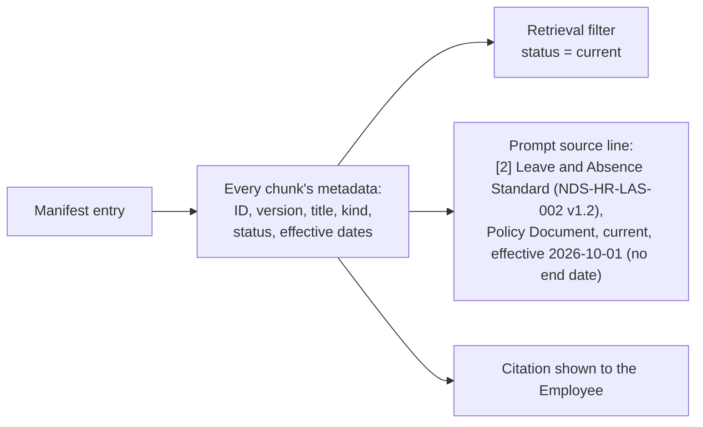

# 02. Corpus and manifest

The **Corpus** is the fixed set of Source Documents HR Assist answers from. The **Corpus Manifest**, [data/manifest.yaml](../data/manifest.yaml), is the only list of what belongs to it. A file that isn't in the manifest is never ingested, even if it sits in `data/policies/`.

## The Source Documents

| File (under `data/policies/`) | Document ID | Kind | Status |
| --- | --- | --- | --- |
| `01_Northstar_Employee_Handbook_v2.0.pdf` | `NDS-HR-HB-001` | Policy Document | current |
| `02_Leave_and_Absence_Standard_v1.2.pdf` | `NDS-HR-LAS-002` | Policy Document | current |
| `03_Expenses_and_Business_Travel_Policy_v1.1.pdf` | `NDS-FIN-EXP-003` | Policy Document | current |
| `04_IT_Security_Data_Protection_and_GenAI_Policy_v2.0.pdf` | `NDS-SEC-ITG-004` | Policy Document | current |
| `05_Hybrid_and_Flexible_Working_Standard_v1.1.pdf` | `NDS-HR-HFW-005` | Policy Document | current |
| `archived/06_ARCHIVED_Superseded_Leave_Policy_v1.0.pdf` | `NDS-HR-LV-006` | Policy Document | superseded (effective from 1 January 2025 until the Leave Standard replaced it on 1 October 2026) |
| `11_Policy_Changes_Oct2026_Manager_Briefing.pptx` | `NDS-HR-PRES-011` | Summary Deck (with speaker notes) | current |
| `12_New_Starter_Induction_First_Six_Months.pptx` | `NDS-HR-PRES-012` | Summary Deck | current |
| `13_Responsible_GenAI_Training_2026.pptx` | `NDS-SEC-PRES-013` | Summary Deck | current |

Every current document takes effect on 1 October 2026.

Not in the Corpus:

- [test_fixtures/10_TEST_FIXTURE_Prompt_Injection_Sample.pdf](../test_fixtures/) is an adversarial document with hidden instructions. It is meant for a separate test index and isn't in the manifest yet.
- [evals/eval_questions.json](../evals/eval_questions.json) is the answer key. It must never be ingested.

All the documents are fictional, written for this project. Statutory figures were checked against GOV.UK and Acas on 13 October 2026 ([data/README.md](../data/README.md)).

## Why a hand-written manifest

Two facts drive how HR Assist reasons: **which kind** a document is (a Policy Document prevails over a Summary Deck) and **when it applies** (its Effective Period). If these were guessed from file names or text, a wrong guess would silently produce wrong answers. A short YAML file that a person reviews in a pull request is safer ([ADR 0001](../docs/adr/0001-document-loading-and-chunking.md)).

## The manifest schema

Each entry is validated by `ManifestEntry` in [corpus/manifest.py](../backend/src/hr_assist/corpus/manifest.py). Unknown keys are rejected.

```yaml
- path: data/policies/02_Leave_and_Absence_Standard_v1.2.pdf
  document_id: NDS-HR-LAS-002
  document_version: v1.2
  title: Leave and Absence Standard
  kind: policy_document        # policy_document | summary_deck | test_fixture
  status: current              # current | superseded
  effective_from: 2026-10-01
  effective_to: null           # null for a current document
  superseded_by: null          # optional: the Document ID that replaced it
```

| Field | Rule |
| --- | --- |
| `path` | Relative to the repo root. Resolved to an absolute path on load |
| `document_id`, `document_version`, `title` | Non-empty strings |
| `kind` | `policy_document`, `summary_deck` or `test_fixture` |
| `status` | `current` or `superseded` |
| `effective_from` | A date |
| `effective_to` | A date or `null`. Must not be before `effective_from` |
| `superseded_by` | Optional. Recorded, but not yet copied into chunks or the prompt |

`load_manifest` raises `ManifestError` when the file is missing, isn't a YAML list, or any entry fails validation. The message names the entry's position.

## The manifest-to-file check

A manifest entry could drift from its file: someone replaces a PDF but forgets to bump the version. Ingestion stops that:

- **PDFs.** Every page's running header must name the manifest's Document ID and Version, for example `... | NDS-HR-LAS-002 | v1.2`. If any page names something else, or no header is found, ingestion fails with a message that prints both ([normaliser.py](../backend/src/hr_assist/ingestion/normaliser.py), `check_running_header`).
- **Decks.** The title slide must print `<Document ID>  ·  Version <n>`, for example `NDS-HR-PRES-011  ·  Version 1.0` (`check_title_slide`).

## Adding a new document

1. Put the PDF or PPTX under `data/policies/`.
2. Add an entry to `data/manifest.yaml` as above.
3. From `backend/`, run `uv run hr-assist ingest`.
4. Read the printed chunk counts. **A PDF with 0 chunks means no numbered section headings were found** (see [03](03_INGESTION_ENGINE.md)).
5. After the change is merged, run **Actions → Ingest (prod)** to rebuild production ([13](13_DEPLOYMENT_AND_CI.md)).

## Superseding a document

1. Add the new version as a new entry.
2. Edit the old entry:
   - `status: superseded`
   - `effective_to:` the day before the new version takes effect
   - `superseded_by:` the new Document ID
3. Optionally move the old file to `data/policies/archived/` and update its `path`.
4. **Keep the old entry.** Its chunks stay in the index, so turning version-aware answers back on later needs only a code change, not a re-ingest.
5. Re-ingest, locally and in production.

Today retrieval skips superseded chunks, so the old version won't be used to answer ([ADR 0007](../docs/adr/0007-search-only-current-documents.md), and [15](15_LIMITATIONS_AND_ROADMAP.md)).

## How the facts flow through the system



The model reads the kind and the dates on every source line, which is how the prompt's rules ("a Policy Document prevails over a Summary Deck", "apply the version in force on the Applicable Date") can work.
