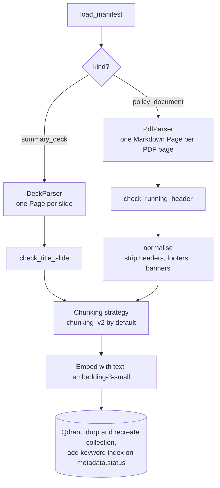

# 03. Ingestion engine

Ingestion turns the Corpus into a searchable Qdrant collection. It runs offline, by hand, from the CLI:

```sh
cd backend
uv run hr-assist ingest                      # uses data/manifest.yaml
uv run hr-assist ingest --manifest other.yaml
```

It takes about a minute and costs a fraction of a cent in embeddings. Each run **rebuilds the whole collection**: the index always matches the manifest exactly.

## The pipeline



| Step | Code |
| --- | --- |
| CLI entry, strategy choice, chunk counts | [cli.py](../backend/src/hr_assist/cli.py) |
| Parse, check, normalise, chunk | [ingestion/pipeline.py](../backend/src/hr_assist/ingestion/pipeline.py) |
| PDF and deck parsers | [ingestion/parser.py](../backend/src/hr_assist/ingestion/parser.py) |
| ID checks and boilerplate removal | [ingestion/normaliser.py](../backend/src/hr_assist/ingestion/normaliser.py) |
| Chunking strategies | [ingestion/chunking.py](../backend/src/hr_assist/ingestion/chunking.py) |
| Embedding and index rebuild | [integrations/qdrant.py](../backend/src/hr_assist/integrations/qdrant.py) (`rebuild_index`) |

## 1. Parsing

**PDFs** are loaded with `PyMuPDF4LLMLoader` in page mode. It outputs **Markdown**, which keeps headings (`## 3.1 Annual leave`) and pipe tables. Plain text extraction loses both, and with them the section structure and table rows the chunker relies on ([ADR 0001](../docs/adr/0001-document-loading-and-chunking.md)). Page numbers are 1-based.

**Decks** are read with `python-pptx`. Each slide becomes one Markdown page:

```text
## <slide title>

<body text, one paragraph per line>

|col|col|
|---|---|
|...|...|

Speaker notes: <notes text>
```

- Group shapes are flattened in reading order.
- Slide-number placeholders, pictures and charts are skipped: they carry no text worth embedding.
- **Speaker notes are kept.** In these decks they hold policy content that isn't on the slide.
- Tables become Markdown tables, with `|` inside a cell escaped.

The parsing libraries are in the `ingest` dependency group. The production Docker image leaves them out, so the API image stays small and ingestion can't run inside it.

## 2. Checking and normalising (PDFs)

`check_running_header` confirms every running header names the manifest's Document ID and Version ([02](02_CORPUS_AND_MANIFEST.md)). Then `normalise` removes boilerplate lines from every page:

| Pattern | Example |
| --- | --- |
| Running header | `Leave and Absence Standard \| NDS-HR-LAS-002 \| v1.2` |
| Company line | `**Northstar Digital Services Ltd.**` |
| Superseded banner | `**SUPERSEDED — NOT FOR CURRENT POLICY DECISIONS**` |
| Running footer | `Internal · ...` or `Internal (ARCHIVED) · ...` |
| Page counter | `Page 4 of 18` |

Without this step, every chunk would repeat the same header and footer, which adds noise to every embedding.

## 3. Chunking

A **chunk** is the unit that is embedded, searched and cited. The strategy is chosen by `CHUNKING_VERSION`. Two exist:

| Version | Size limit / overlap (tokens) | Splits an oversized section | Status |
| --- | --- | --- | --- |
| `chunking_v1` (`StructureV1`) | 500 / 60 | By packing whole paragraphs and tables | Kept for comparison |
| `chunking_v2` (`StructureV2`) | 500 / 100 | First at unnumbered headings (worked examples, cards, appendices), then by packing | **Default** ([ADR 0005](../docs/adr/0005-split-oversized-sections-at-unnumbered-headings.md)) |

`CHUNK_MAX_TOKENS` and `CHUNK_OVERLAP_TOKENS` override the sizes. The overlap must be smaller than the limit, or the CLI exits with an error. Tokens are counted with `tiktoken`'s `o200k_base` encoding.

### PDFs: one chunk per numbered section

1. **Find the sections.** A line is a section heading if it is a Markdown heading followed by a number: `## 3.1 Annual leave`, `# **4 Expenses**`. The PDFs use heading levels inconsistently (3.1 may be `##` and 3.3 `#`), so the **hierarchy comes from the section numbers**, not the `#` count. Everything before the first numbered section (cover, document control, contents) is dropped.
2. **Split the section body into blocks** at blank lines. A block is a paragraph, a list item or a table. A heading or a `**Table ...**` caption is **glued to the block after it**, so a caption never lands in a different chunk from its table.
3. **Fits in the limit?** The whole section is one chunk. Most sections are.
4. **Oversized?**
   - `chunking_v1` packs blocks into parts up to the limit, carrying trailing paragraphs into the next part as overlap. A paragraph that alone exceeds the limit is split with LangChain's `RecursiveCharacterTextSplitter`.
   - `chunking_v2` first groups blocks at **unnumbered headings**, so a worked example stays whole with its scenario and calculation. Whole groups are packed into parts. A group that alone exceeds the limit is packed as in v1, with **its heading repeated at the top of each later part**, so every part says what it belongs to.
5. **Tables are never split.** A part holding a long table can exceed the limit. Some chunks are close to 900 tokens for this reason.
6. Each part records the **pages its own text sits on**, so a Citation can say `pp.4-5`.

### Decks: one chunk per slide

Each slide is one chunk, located by its slide number, not pages. Its title is the section title.

### What a chunk looks like

The embedded text starts with header lines that put the chunk in context, then a blank line, then the body:

```text
Leave and Absence Standard (NDS-HR-LAS-002 v1.2, current, effective 2026-10-01)
3 Annual leave > 3.1 Entitlement

**Table 3.1 Annual leave by length of service**

|Completed years|Days|
|---|---|
|...|...|
```

The header lines make the embedding aware of which document and section the text comes from. The UI shows only the **body** (`Chunk.body`), as the Citation snippet.

### Chunk metadata

Stored as the Qdrant payload under `metadata` ([corpus/chunk.py](../backend/src/hr_assist/corpus/chunk.py)):

| Field | Example |
| --- | --- |
| `document_id`, `document_version`, `title` | `NDS-HR-LAS-002`, `v1.2`, `Leave and Absence Standard` |
| `document_kind`, `status` | `policy_document`, `current` |
| `effective_from`, `effective_to` | `2026-10-01`, `null` |
| `section_number`, `section_title` | `3.1`, `Entitlement` (`null` number for a slide) |
| `section_path` | `["3 Annual leave", "3.1 Entitlement"]` |
| `page_start`, `page_end` **or** `slide` | `4`, `5` or `7`. A validator enforces exactly one of the two |
| `chunking_version` | `chunking_v2` |

### Stable chunk IDs

Each ID is a UUIDv5 of `document_id|document_version|section|part` (or `slide N`). The same input always produces the same ID, so eval goldens and log lines can refer to a chunk across rebuilds.

## 4. Embedding and indexing

`rebuild_index` embeds every chunk with `EMBEDDING_MODEL` and writes them to Qdrant with `force_recreate=True`: **the collection is dropped and rebuilt**. It then creates a **keyword payload index on `metadata.status`**, which Qdrant Cloud requires before retrieval can filter on it.

The collection name is:

```text
<APP_ENV>-<CHUNKING_VERSION>-<EMBEDDING_MODEL>
e.g. development-chunking_v2-text-embedding-3-small
     prod-chunking_v2-text-embedding-3-small
```

So changing the chunking version or the embedding model creates a **new** collection and leaves the old one for comparison. Changing only the chunk **sizes** keeps the same name, so the re-ingest **overwrites** it ([14](14_KNOWN_GOTCHAS.md)).

## Output

One line per Source Document, then a summary (counts shown as `<n>`):

```text
NDS-HR-HB-001 v2.0: <n> chunks
NDS-HR-LAS-002 v1.2: <n> chunks
...
Rebuilt development-chunking_v2-text-embedding-3-small with 408 chunks
```

The current Corpus gives **408 chunks with `chunking_v2`** and 405 with `chunking_v1` (from the latest eval summaries).

## Adding a chunking strategy

1. Write a class with a `version` attribute and `chunk(entry, pages) -> list[Chunk]` (the `ChunkingStrategy` Protocol). Subclassing `StructureV1` gives you the helpers.
2. Add it to `STRATEGIES` in `chunking.py`.
3. Set `CHUNKING_VERSION=<new version>` and ingest. You get a new collection.
4. Rebuild the generation goldens for that version, then compare with the evals ([12](12_EVALS_PIPELINE.md)).

## Tests

[tests/ingestion/test_pipeline.py](../backend/tests/ingestion/test_pipeline.py) runs ingestion on the **real** documents and checks, among other things, that Table 3.1 of the Leave Standard is one whole chunk, tables are never split, headers and footers are gone, page numbers are right, contents pages give no chunks, slides keep their notes, and a wrong manifest version fails. See [10](10_TESTING.md).
