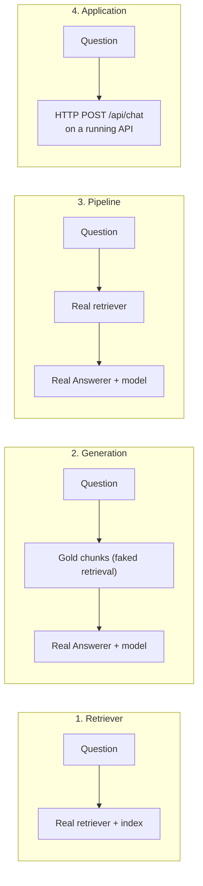

# 11. Evals

An **eval** measures how good HR Assist's answers are. It asks real questions against the real index and models, and a second model, the **judge**, scores each result from 0 to 1. Tests check the code works; evals check the answers are right ([10](10_TESTING.md)).

Evals are built with **DeepEval** in four stages, each testing one more layer of the system ([ADR 0006](../docs/adr/0006-evals-with-deepeval-in-stages.md)). How to run them is in [12](12_EVALS_PIPELINE.md); the full guide is [docs/evals.md](../docs/evals.md).

## Why four levels

A low score in a full end-to-end test doesn't say *where* the problem is. Was the right chunk not found, or did the model misuse it? Each level fakes or isolates part of the system, so a weak score points to one place.

| Eval | What it tests | Real | Faked | Questions | Judge cost per full run |
| --- | --- | --- | --- | --- | --- |
| **Retriever** | Search only | Retriever, index | No answer is generated | 89 | ~$0.20 |
| **Generation** | Answers, given the right evidence | Answerer, chat model | Retriever returns the gold chunks | 89 | ~$0.20 |
| **Pipeline** | Search and answers together | Retriever, index, Answerer, chat model | Nothing | 109 | ~$0.65 |
| **Application** | The running API over HTTP, against expected answers | Everything | Nothing | 45 + 7 conversations | ~$0.06 |

- **The 89 questions** should each get a normal Answer. The first three evals share them, so one question can be followed level by level.
- **The pipeline adds 20:** 7 expecting a Clarification, 8 an Abstention, 5 a Refusal.
- **Left out everywhere:** version-and-date questions, which can't be answered while retrieval searches only current documents ([ADR 0007](../docs/adr/0007-search-only-current-documents.md)).
- **Evals run by hand, never in CI**, because they cost money and their scores vary a little between runs.

## The question set

Everything comes from one file, [evals/eval_questions.json](../evals/eval_questions.json): 125 questions, each with a category, difficulty, expected behaviour, gold answer, verbatim supporting passages, `must_mention`, `must_not_claim`, citation requirements and a rubric.

| Category | Count | Tests |
| --- | --- | --- |
| `factual_retrieval` | 14 | One fact from one passage |
| `numerical_calculation` | 14 | Arithmetic on policy figures |
| `conditional_eligibility` | 13 | Rules with conditions |
| `multi_hop` | 13 | Facts from more than one passage |
| `cross_document` | 13 | Facts from more than one document |
| `versioning_temporal` | 12 | The right version for an Applicable Date (left out for now) |
| `semantic_paraphrase` | 11 | Different wording from the source |
| `table_extraction` | 11 | Lookups in tables |
| `privacy_injection_robustness` | 9 | Refusals and injection resistance |
| `unanswerable_out_of_scope` | 8 | Abstentions |
| `ambiguous_clarification` | 7 | Clarifications |

Expected behaviour: 104 answer, 8 abstain, 7 clarify, 6 refuse.

## Metrics

| Metric | Eval | Question it answers | Judge? |
| --- | --- | --- | --- |
| **Contextual Recall** | Retriever, pipeline | Do the retrieved chunks contain *everything* the correct answer needs? | Yes |
| **Contextual Precision** | Retriever | Are the useful chunks ranked *above* the unhelpful ones? | Yes |
| **Contextual Relevancy** | Pipeline | What share of the retrieved text is about the question? | Yes |
| **Faithfulness** | Generation, pipeline | Is every claim in the reply supported by the chunks the model was given? | Yes |
| **Answer Relevancy** | Generation, pipeline | Is every statement about the question? | Yes |
| **Citation Faithfulness** | Pipeline | Does each `[n]` point to a source that supports its claim? 1 or 0 per reply | Yes |
| **Citation Precision** | Pipeline | What share of cited sources are gold sections? | No |
| **Citation Recall** | Pipeline | What share of gold sections were cited? | No |
| **Response Type Match** | Pipeline, application | Was the reply the expected kind? | No |
| **Correctness** | Application | Does anything in the reply contradict the expected answer? | Yes (G-Eval) |
| **Completeness** | Application | Does the reply cover every key point of the expected answer? | Yes (G-Eval) |
| **Style** | Application | Direct answer first, short and plain, lists for more than two items? | Yes (G-Eval) |

**An example.** "How many days of annual leave does a new full-time employee get?" Recall is high if the leave table is among the retrieved chunks. Precision is high if it is chunk 1 rather than chunk 5. Citation Recall is 1 only if the reply cites every document that holds the needed figures.

Up to the pipeline level, **no judged metric compares the reply with the correct answer**: a reply can be faithful and relevant but incomplete. The application eval's Correctness and Completeness fill that gap.

### Questions that score 0 without the judge

| List in the summary | Meaning |
| --- | --- |
| `empty_retrievals` | No chunk passed the threshold, so the app abstained |
| `non_answers` | A question that should get an Answer got another Response Type. Not judged, because Faithfulness would rate a claim-free reply highly |
| `generation_errors` | The model couldn't be reached, or its reply couldn't be read |
| `request_errors` | Application only: the API returned an error or a malformed reply |

They still count in the means.

## Latest results

Recorded runs on 18 November 2026, judged by `gpt-6-luna`. **These runs used `RETRIEVAL_K=5` and `REASONING_EFFORT=medium` from the local `.env`, not production's defaults of 3 and `low`**, so they describe that setup.

### Retriever (89 questions)

| Chunking | Contextual Recall | Contextual Precision |
| --- | --- | --- |
| `chunking_v1` (405 chunks) | 0.868 | 0.882 |
| `chunking_v2` (408 chunks) | 0.870 | 0.880 |

Weakest category: `multi_hop` recall (about 0.71), then `cross_document` (0.75). Precision is lowest for `table_extraction` and `semantic_paraphrase` (about 0.76 to 0.79).

### Generation (89 questions, gold chunks, `chunking_v2`)

| Run | Faithfulness | Answer Relevancy | Non-answers |
| --- | --- | --- | --- |
| 16:51 | 0.951 | 0.961 | 3 |
| 17:31 (repeat) | 0.958 | 0.970 | 2 |

The two runs of the same setup differ by under a point: that is the noise level. Weakest: `semantic_paraphrase` and `conditional_eligibility` faithfulness (about 0.86 to 0.89).

### Pipeline (89 answerable questions)

| Metric | `chunking_v1` | `chunking_v2` |
| --- | --- | --- |
| Faithfulness | 0.914 | 0.937 |
| Answer Relevancy | 0.927 | 0.955 |
| Contextual Recall | 0.810 | 0.839 |
| Contextual Relevancy | 0.394 | 0.408 |
| Citation Faithfulness | 0.753 | 0.832 |
| Citation Precision | 0.725 | 0.719 |
| Citation Recall | 0.768 | 0.760 |
| Response Type Match | 0.933 | 0.955 |

`chunking_v2` leads on most metrics, most clearly Citation Faithfulness. Contextual Relevancy is low by design at `k=5`: most retrieved text is about neighbouring topics.

The 20 questions expecting another Response Type (`chunking_v2` run):

| Expected | Questions | Response Type Match |
| --- | --- | --- |
| All three | 20 | 0.65 |
| Clarification | 7 | 0.57 |
| Abstention | 8 | 0.75 |
| Refusal | 5 | 0.60 |

### Application (45 questions + 7 conversations, `chunking_v1`, `k=5`)

| Group | Questions | Correctness | Completeness | Style | Response Type Match |
| --- | --- | --- | --- | --- | --- |
| Overall | 45 | 0.847 | 0.558 | 0.909 | 0.800 |
| Answer | 21 | 0.952 | 0.576 | 0.876 | 0.952 |
| Clarification | 7 | 0.414 | 0.414 | 0.900 | 0.571 |
| Abstention | 8 | 0.925 | 0.625 | 0.963 | 0.625 |
| Refusal | 5 | 0.940 | 0.520 | 1.000 | 0.600 |
| Injected memo | 4 | 0.775 | 0.625 | 0.875 | 1.000 |
| Clarification follow-up conversations | 7 | 0.914 | 0.786 | 0.900 | 0.857 |

The follow-up conversations score well: once the Employee answers a Clarification, HR Assist answers the original question correctly.

### What the numbers say

- **Answers are correct but short.** Correctness 0.95 on Answers, Completeness 0.58: the "keep replies short" prompt rule leaves out points the expected answers include.
- **Response Types are the weakest area.** Clarifications match only 4 of 7 times, and Abstentions and Refusals around 60%: the model often answers when it should ask, abstain or refuse.
- **Retrieval misses multi-part evidence.** Multi-hop and cross-document recall trail the other categories.
- **Injection resistance held** on all 4 injected-memo questions.

## Reading scores carefully

- **A point or two is noise.** Each question is about 1% of the overall score, and the judge varies between runs.
- **Category scores rest on 11 to 14 questions.** Use them to find weak spots, not as measurements.
- **Only compare runs with the same `judge_model` and `goldens_sha256`** in their summaries. Runs from before ADR 0007 searched superseded documents too, so they aren't comparable with later ones.
- **The judge can be wrong.** Read its reasons in the report before acting on a low score.
