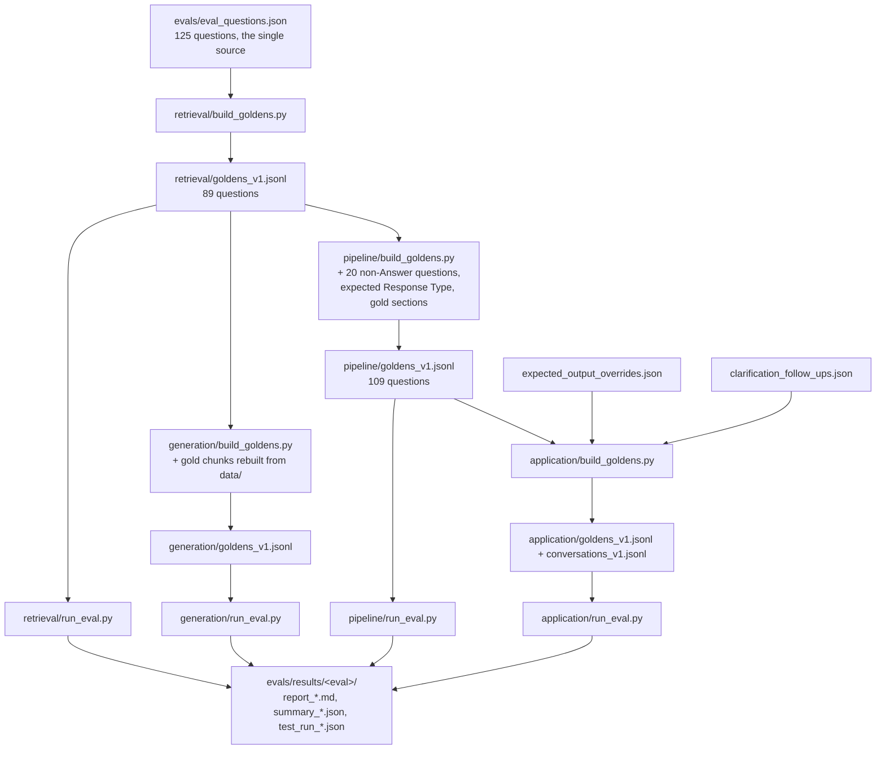

# 12. Evals pipeline

This file is the working guide: how eval data is built, how a run works, what it writes, and how to use runs to make a decision. What the evals measure is in [11](11_EVALS.md). The longer reference is [docs/evals.md](../docs/evals.md).

## The flow



## Folder layout

```text
evals/
├── eval_questions.json          the 125 questions and answer key (never ingested)
├── baseline_manual_v1.csv       a sheet for a manual baseline run (hit@k, reciprocal rank)
├── retrieval/                   build_goldens.py, goldens_v1.json(l), run_eval.py
├── generation/                  build_goldens.py, goldens_v1.json(l), run_eval.py
├── pipeline/                    build_goldens.py, goldens_v1.json(l), run_eval.py
├── application/                 build_goldens.py, goldens + conversations, run_eval.py,
│                                expected_output_overrides.json, clarification_follow_ups.json
└── results/<eval>/              every recorded run
```

## Setup

- The backend set up as in [README.md](../README.md), with `.env` at the repo root.
- An `OPENAI_API_KEY` that can use both the chat model and the judge (`EVAL_JUDGE_MODEL`, default `gpt-5.6-luna`; the latest runs used `gpt-6-luna`).
- For the retriever and pipeline evals, **the collection ingested** for your `.env`'s `APP_ENV`, chunking version and embedding model: `cd backend && uv run hr-assist ingest`.
- DeepEval comes from the `evals` dependency group; `--group evals` installs it on first use.

**Whatever is in `.env` is what gets measured.** The runners read the same `Settings` as the app.

## Running an eval

From the **repo root**:

| Eval | Command |
| --- | --- |
| Retriever | `uv run --project backend --group evals python evals/retrieval/run_eval.py` |
| Generation | `uv run --project backend --group evals python evals/generation/run_eval.py` |
| Pipeline | `uv run --project backend --group evals python evals/pipeline/run_eval.py` |
| Application | `uv run --project backend --group evals python evals/application/run_eval.py` |

Common flags:

| Flag | Effect |
| --- | --- |
| `--limit N` | Run only the first N questions. Use 3 as a smoke test (about $0.01) |
| `--judge-model <model>` | Override `EVAL_JUDGE_MODEL` for this run. Scores from different judges can't be compared |
| `--base-url <url>` | Application only: the API to test. Default `http://localhost:8000` |

### The routine

1. **Smoke test** with `--limit 3`. Then delete its files from `evals/results/<eval>/`, so nobody mistakes it for a real run.
2. **Full run** without `--limit`. It prints a score table, the judge cost and the files it wrote.
3. **Commit every file** the run wrote, so later runs have something to compare against.

### What each runner does

| Runner | Steps |
| --- | --- |
| Retriever | For each golden, call `QdrantRetriever.retrieve`; judge Contextual Recall and Precision against the gold answer |
| Generation | Feed the **gold chunks** to the real `Answerer` through a fake retriever; judge Faithfulness and Answer Relevancy |
| Pipeline | Run the real `Answerer` with a recording retriever and a token-recording model, 8 questions at a time; judge the RAG triad, Contextual Relevancy and Citation Faithfulness; compute Citation Precision, Recall and Response Type Match in code |
| Application | `POST /api/chat` on a running API, 4 at a time, at most `RATE_LIMIT_PER_MINUTE` per minute, up to 3 attempts per request; judge Correctness, Completeness and Style with G-Eval rubrics; replay 7 three-turn Clarification conversations |

### The application eval needs a running API

- Start it from `backend/`: `uv run uvicorn hr_assist.api.app:create_app --factory`. **Restart it after any code or `.env` change.**
- A full run takes about 3 minutes and uses 52 of your IP's 100 chats for the day.
- The API doesn't report its settings, so the summary records your `.env`'s. They describe the server only if it runs the same `.env` and code.

## The output files

Each run writes to `evals/results/<eval>/`, named with the run's date and time:

| File | Contents | Use it to |
| --- | --- | --- |
| `report_*.md` | Settings, score tables, then every question **lowest score first**: expected answer, reply, the judge's reasons, chunks and citations | **Start here** |
| `summary_*.json` | `hyperparameters` (every setting, prompt version, judge, goldens hash), judge cost, means overall and by category, per-question scores, and the zero-score lists | Compare runs |
| `test_run_*.json` | DeepEval's full record, with every verdict and chunk text. The pipeline and application evals write two each | Read a chunk's full text |

Open a report in VS Code with Cmd+Shift+V (Ctrl+Shift+V on Windows and Linux), or on GitHub.

## Diagnosing a low score

| You see | Likely cause | Look at |
| --- | --- | --- |
| Low Contextual Recall | Search didn't find the right chunk | Chunking, embeddings, `RETRIEVAL_K` |
| Low Contextual Precision only | Found, but ranked low | Embeddings, a reranker |
| Low Contextual Relevancy, good recall | Right text among a lot of unrelated text | `RETRIEVAL_K`, chunk size, threshold |
| Low Faithfulness, good recall | The model said more than its sources | Prompt, chat model |
| Low Citation Recall, good recall | The model had the source but didn't cite it | Prompt |
| Wrong Response Type | Clarified, abstained or refused when it shouldn't, or the reverse | The prompt's Response Type rules |
| Low Correctness naming a true extra detail | The application judge sees only the expected answer | Check the detail in the policy |
| A reason that doesn't fit the reply | The judge got it wrong | Note it |

## Comparing two setups

### What you can change

| Setting (in `.env`) | Affects | Re-ingest? |
| --- | --- | --- |
| `RETRIEVAL_K`, `RETRIEVAL_SCORE_THRESHOLD` | Retriever, pipeline | No |
| `CHAT_MODEL`, `REASONING_EFFORT`, `MAX_OUTPUT_TOKENS` | Generation, pipeline | No |
| `CHUNKING_VERSION`, `EMBEDDING_MODEL` | Retriever, pipeline | Once per value: each gets its own collection |
| `CHUNK_MAX_TOKENS`, `CHUNK_OVERLAP_TOKENS` | Retriever, pipeline | **Every time**, and it overwrites the current collection |
| The prompt, the metrics | Generation, pipeline, application | No, but they're code changes |

### The steps

1. Run the eval on the current setup.
2. Change **one** setting in `.env`.
3. Re-ingest if the table says so, then run again.
4. Compare `means` in the two summaries: overall first, then by category.
5. **Set `.env` back**, because your local app reads it too.
6. If the new value is better, change the default in `config/settings.py` (or `deploy.yml`) in a PR, with the two summaries as evidence. Production has no `.env`, so this is what makes it live.

Two runs are comparable only if their summaries show the same `judge_model` and `goldens_sha256`.

Example: compare chunking versions ([ADR 0005](../docs/adr/0005-split-oversized-sections-at-unnumbered-headings.md)).

```sh
# CHUNKING_VERSION=chunking_v1 in .env
cd backend && uv run hr-assist ingest && cd ..
uv run --project backend --group evals python evals/retrieval/run_eval.py
# CHUNKING_VERSION=chunking_v2 in .env
uv run --project backend --group evals python evals/retrieval/run_eval.py
```

## Building the goldens

A **golden** is one test question with its correct answer and evidence. All goldens are generated from `eval_questions.json`. **Never edit a golden file by hand.**

| Golden file | Command (from the repo root) | Adds | Rebuild when |
| --- | --- | --- | --- |
| `retrieval/goldens_v1.jsonl` | `python evals/retrieval/build_goldens.py` | The question list itself | The questions change |
| `generation/goldens_v1.jsonl` | `uv run --project backend python evals/generation/build_goldens.py` | Gold chunks, rebuilt from `data/` as ingestion does (about 25 seconds, free) | Questions, ingestion or chunking change |
| `pipeline/goldens_v1.jsonl` | `uv run --project backend python evals/pipeline/build_goldens.py` | Expected Response Type and the gold sections to cite | Questions or manifest change |
| `application/goldens_v1.jsonl`, `conversations_v1.jsonl` | `uv run --project backend python evals/application/build_goldens.py` | A 45-question sample of the pipeline goldens, plus 7 follow-up conversations | Pipeline goldens or either hand-written file change |

Rules:

- **Build in order:** retrieval first, then generation and pipeline, then application.
- **Read each script's output.** It prints counts and any passage with no matching chunk.
- **Commit each `.jsonl` with its pretty-printed `.json` copy.** The runners load only the `.jsonl`.
- **The scripts stop** on duplicate IDs, unknown Document IDs, a missing gold answer or passages, or a section sign in the source. Write "section 6.1".
- **A new question set means a new file** (`goldens_v2.jsonl`), not an overwrite: scores from different sets aren't comparable. Update `OUTPUT` in the build script and `GOLDENS` in the runner.
- **Another chunking version also means a new file**, for example `build_goldens.py --chunking chunking_v1 --output evals/generation/goldens_chunking_v1.jsonl`.

### The application goldens

`goldens_v1.jsonl` holds 45 questions: 3 Answer questions per category (hardest first), every Clarification, Abstention and Refusal question, and the 4 injected-memo questions. `conversations_v1.jsonl` holds 7 three-turn conversations: a vague question, HR Assist's Clarification, and the Employee's reply; the judge scores the next reply.

Two hand-written files feed it. Edit these, never the goldens:

| File | Holds | Why hand-written |
| --- | --- | --- |
| `expected_output_overrides.json` | Expected outputs for the injected-memo questions (112, 114, 115, 117), with reasons | Their gold answers name a test document that isn't indexed |
| `clarification_follow_ups.json` | For each Clarification question: the Employee's reply, the expected Answer and its sources | The question set has the vague questions but no replies |

## Troubleshooting

| You see | Do |
| --- | --- |
| `Collection ... doesn't exist; ingest first` | `uv run hr-assist ingest` from `backend/` with the same `.env` |
| `ValidationError` for `Settings` | Create `.env` from `.env.example` |
| `No module named 'deepeval'` | Keep `--group evals` in the command |
| `can't open file '.../run_eval.py'` | Run from the repo root |
| `'temperature' does not support 0.0 with this model` | DeepEval doesn't know that judge. Use a supported judge model |
| Every question in `empty_retrievals` | Empty collection or too high a threshold |
| Many `non_answers` | The model clarifies or abstains too often. Read those replies before blaming retrieval |
