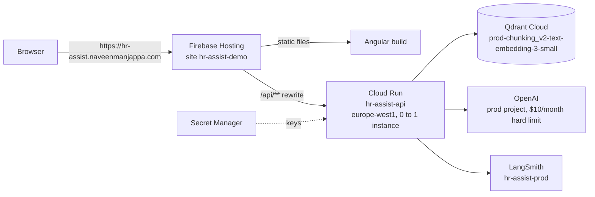
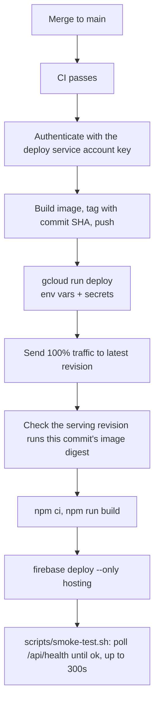

# 13. Deployment and CI/CD

HR Assist runs on Google Cloud and Firebase, deployed by GitHub Actions. This file is the overview. The full explanation and decision log are in [docs/deployment.md](../docs/deployment.md); the one-time setup runbook is [docs/deployment-setup.md](../docs/deployment-setup.md); the custom-domain runbook is [docs/go-live.md](../docs/go-live.md).

## Production topology



| Piece | Choice | Why |
| --- | --- | --- |
| Frontend hosting | **Firebase Hosting** | Free CDN, HTTPS, custom domain; serves the page instantly even while the API is cold |
| Same-origin API | Firebase **rewrite** of `/api/**` to Cloud Run ([firebase.json](../firebase.json)) | One origin, so no CORS in production. Other paths fall back to `index.html` |
| Backend | **Cloud Run**, service `hr-assist-api`, region `europe-west1` | Containers that scale to zero; free tier covers the demo |
| Scaling | `--min-instances 0 --max-instances 1` | No idle cost; one instance keeps the in-memory rate limits correct ([08](08_GUARDRAILS_AND_USAGE_LIMITS.md)) |
| Secrets | **Secret Manager**: `openai-api-key`, `qdrant-api-key`, `langsmith-api-key` | One place to rotate; never stored in GitHub |
| Images | **Artifact Registry**, repository `hr-assist`, tagged with the commit SHA | |
| Identity | Two service accounts: `hr-assist-runtime` (what Cloud Run runs as) and a deploy account (what GitHub Actions uses) | Least privilege |

`index.html` is served with `Cache-Control: no-cache`, so a new deploy is picked up on the next page load.

## The container

[backend/Dockerfile](../backend/Dockerfile), built from the repo root:

```sh
docker build -f backend/Dockerfile -t hr-assist-api .
docker run --rm --env-file .env -p 8080:8080 hr-assist-api   # health: localhost:8080/api/health
```

- Two stages: a `uv` builder, then a slim `python:3.13-slim` runtime.
- **Runtime dependencies only:** no `dev` group and no `ingest` group, so no PDF or PPTX libraries. Ingestion can't run in the container.
- Dependencies are installed before the source is copied, so code changes don't reinstall them.
- Runs as a non-root `app` user (UID 10001).
- Listens on `$PORT` (Cloud Run sets it; default 8080). `exec` makes uvicorn receive SIGTERM directly.

## The workflows

| Workflow | Trigger | Does |
| --- | --- | --- |
| [CI](../.github/workflows/ci.yml) | Every PR and push to `main` | Backend checks, Docker build and import check, frontend checks ([10](10_TESTING.md)) |
| [Deploy](../.github/workflows/deploy.yml) | CI succeeded on a **push** to `main` | Build, push, deploy Cloud Run, verify, deploy Firebase, smoke test |
| [Ingest (prod)](../.github/workflows/ingest-prod.yml) | Manual only | Rebuild the prod Qdrant collection |
| [Qdrant keep-alive](../.github/workflows/qdrant-keep-alive.yml) | Mondays and Thursdays 06:17 UTC, or manual | Call `/api/health` so the free cluster isn't suspended |

### Deploy, step by step



- **Only after CI**, and only for a push, never for a PR from a branch that happens to be called `main`.
- **One deploy at a time.** A newer merge waits for the running deploy rather than cancelling it.
- **`--to-latest`** undoes any console rollback: merging is how you change what runs.
- **Digest check.** Cloud Run records images by digest, so the workflow compares the serving revision's image with the pushed tag's `linux/amd64` digest, and fails if they differ.
- **Smoke test** through the public URL, polling every 10 seconds for up to 5 minutes to cover a cold start.

To re-run a failed deploy after fixing its cause: `gh run rerun <run-id> --failed`. It deploys the same commit.

### Production ingest

The prod collection is **not** rebuilt on deploy. After changing documents, the manifest or chunking, run **Actions → Ingest (prod) → Run workflow**.

- `APP_ENV=prod`, `QDRANT_URL` from a repo variable.
- The OpenAI and Qdrant keys are read from Secret Manager **inside the one step that uses them** and masked immediately, so they never reach a laptop or the log.
- Installs only runtime and ingest dependencies (`uv sync --locked --no-dev`).
- **The collection is dropped and rebuilt**, so expect about a minute of failed or poor answers ([14](14_KNOWN_GOTCHAS.md)).

## Configuration in GitHub

| Kind | Name | Holds |
| --- | --- | --- |
| Secret | `GCP_SA_KEY` | The deploy service account's JSON key, on one line |
| Variable | `GCP_PROJECT_ID`, `GCP_REGION` | Where to deploy |
| Variable | `QDRANT_URL` | The prod cluster |
| Variable | `TRUSTED_PROXY_HOPS` | `2` (Firebase puts the visitor second from the right) |
| Variable | `API_URL` | The site the keep-alive pings. Empty makes it a no-op |

Deploys authenticate with a service account key. [ADR 0004](../docs/adr/0004-service-account-key-before-wif.md) records the plan to move to Workload Identity Federation; until then, rotate the key every 90 days.

## Costs

| Item | Expected cost | Limit to know |
| --- | --- | --- |
| Cloud Run | $0 within the free tier | At most 1 instance; cold starts |
| Artifact Registry | A few cents | Delete old images if they pile up |
| Firebase Hosting | $0 | **60 seconds per request** |
| Secret Manager | $0 | |
| Qdrant Cloud | $0 (free cluster) | Suspended after a week idle, deleted after four; the keep-alive prevents it |
| OpenAI | About $0.001 per chat | $10/month hard limit |
| LangSmith | $0 (free tier) | Monthly trace quota |

A GCP budget alert emails at $5 a month.

## Running locally instead

| Goal | Command |
| --- | --- |
| Backend + frontend together | `npm run dev` from the repo root |
| Backend only | `cd backend && uv run uvicorn hr_assist.api.app:create_app --factory --reload` |
| The production image | `docker build` / `docker run` as above |
| Rebuild your dev index | `cd backend && uv run hr-assist ingest` |

## Troubleshooting

| Symptom | Likely cause | Check |
| --- | --- | --- |
| Status shows "Checking…" for a few seconds | Cold start | Normal. Over 30 seconds: Cloud Run logs |
| `504` on `/api/chat` | Over Firebase's 60-second limit | The request's logs by `X-Request-ID` |
| `503 upstream_unavailable` | Qdrant or OpenAI failed, or the spending limit was hit | Qdrant status; OpenAI usage |
| Every chat `503` "Searching the policy index failed." but health is `ok` | The prod collection isn't built | Run **Ingest (prod)** |
| `429 rate_limited` for real visitors | Limits too tight, or `TRUSTED_PROXY_HOPS` wrong so visitors share a bucket | The `X-Forwarded-For` log lines |
| Deploy: `uploadArtifacts denied` or another `Permission denied` | A missing IAM role | [deployment-setup.md](../docs/deployment-setup.md), "If something goes wrong" |
| Deploy succeeded, smoke test failed | Missing secret, wrong env var, or rewrite not deployed | Cloud Run revision logs; `firebase.json` |
| Keep-alive stopped running | GitHub disables scheduled workflows after 60 days without repo activity | Re-enable it in the Actions tab |
