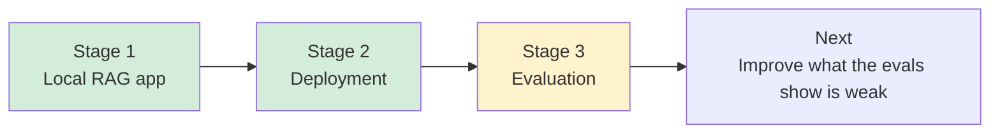

# 15. Limitations and roadmap

What HR Assist can't do yet, what each gap costs, and the planned direction. The order of future work is meant to follow the eval results ([11](11_EVALS.md)), not a fixed plan.

## Answer quality

| Limitation | Effect | Possible fix |
| --- | --- | --- |
| **Response Types are often wrong for non-Answers** | In the latest pipeline run only 65% of Clarification, Abstention and Refusal questions got the expected type; Clarifications 57% | Sharpen the prompt's Response Type rules with examples; re-measure with the pipeline and application evals |
| **Answers are correct but incomplete** | Application Completeness 0.56 against Correctness 0.85 | Loosen the "keep replies short" rule for multi-part questions, then check Style doesn't drop |
| **Multi-part evidence is missed** | Multi-hop and cross-document recall trail other categories (about 0.71 to 0.75) | A larger `k` with a reranker, or query decomposition |
| **Follow-ups keep one question of context** | A follow-up about something asked two or more questions earlier searches without it | A query-rewrite step that uses the history |
| **Only current documents are searched** | Questions about past dates get today's rules or an Abstention ([ADR 0007](../docs/adr/0007-search-only-current-documents.md)) | Reserved places for superseded chunks, or an Applicable Date step before retrieval |
| **Summary Decks compete with Policy Documents** | Deck slides can take places a Policy Document needed; only the prompt decides which prevails | A reranker, or a boost for Policy Documents |
| **No hybrid search** | Exact terms, such as a form name or a code, can rank low | Sparse (BM25) vectors in Qdrant alongside the dense ones |
| **A cited chunk may not support its claim** | Citation Faithfulness is 0.83 in the latest pipeline run | A verification step, or asking the model for a quote and checking it's in the chunk |
| **The snippet is the whole chunk** | Readers must find the supporting sentence in a long card | Highlight a verified quote |
| **`superseded_by` isn't used after the manifest** | The model can't name a replacement document | Add it to chunk metadata and the source line |
| **The injection fixture isn't indexed** | The adversarial PDF isn't tested directly | A test index with the fixture, and its 9 robustness questions |

## Operations

| Limitation | Effect | Possible fix |
| --- | --- | --- |
| **Single instance, in-memory counters** | Can't scale out; limits reset on restart | Redis or Firestore for the counters |
| **Ingestion drops the collection first** | About a minute of failed answers per rebuild | Build a new collection, then switch a Qdrant alias |
| **Health doesn't check the collection** | `ok` while every chat fails | Check `settings.collection_name` exists |
| **Cold starts** | The first question after idle waits a few seconds | `min-instances=1` (about $5 to $10 a month) |
| **No streaming** | The reply appears all at once; Firebase stops requests at 60 seconds | Server-Sent Events |
| **Plain-text logs** | Cloud Logging can't filter on fields | JSON log lines |
| **Service account key for deploys** | A long-lived credential | Workload Identity Federation ([ADR 0004](../docs/adr/0004-service-account-key-before-wif.md)) |

## Security and privacy

| Limitation | Effect | Possible fix |
| --- | --- | --- |
| **Public `run.app` URL** | Bots can skip Firebase and forge `X-Forwarded-For` | Firebase App Check (planned) |
| **Prompt-level guardrails** | Privacy and injection rules depend on the model | An output check step; keep measuring with the evals ([08](08_GUARDRAILS_AND_USAGE_LIMITS.md)) |
| **Conversations are logged** | Questions go to LangSmith; IPs stay in Cloud Run logs for 30 days | The UI says so on first load |
| **Client-controlled history and date** | A client can send fake assistant turns or any `as_of_date` | Low risk with no private data |
| **OpenAPI docs are public** | `/docs` and `/openapi.json` show the schema | Turn them off in production |
| **AGPL dependency in ingestion** | PyMuPDF4LLM's licence | Review before any closed-source use |

## API

- `404` and `405` use FastAPI's default `{"detail": ...}` shape, not the shared error envelope.
- No retry on upstream failures beyond the OpenAI client's own retries: one failed Qdrant call is a `503`.
- When `as_of_date` is missing, the server's date (UTC on Cloud Run) is used. The UI always sends the local date.

## Roadmap

| Stage | Status | Content |
| --- | --- | --- |
| 1. Local RAG app | Done | Ingestion, answering, API, UI |
| 2. Deployment | Done | Cloud Run, Firebase Hosting, CI/CD, usage limits, custom domain |
| 3. Evaluation | In progress | Retriever, generation, pipeline and application evals built and recorded. Remaining: check the judge against a hand-labelled sample |
| Next | Planned, ordered by eval results | Response Type accuracy and completeness (prompt), then retrieval: query rewriting, reranking or Policy Document boost, hybrid search; version-aware answers; zero-downtime re-indexing |
| Later | Planned | Firebase App Check; Workload Identity Federation |

Every change in "Next" should follow the same loop: run the relevant eval, change one thing, run it again, and move the default only with the two summaries as evidence ([12](12_EVALS_PIPELINE.md)).
